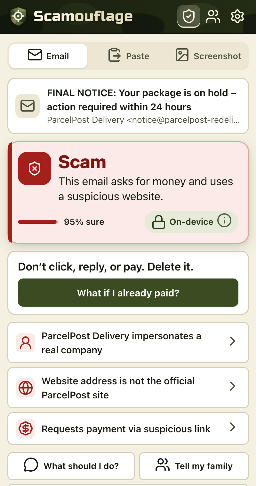
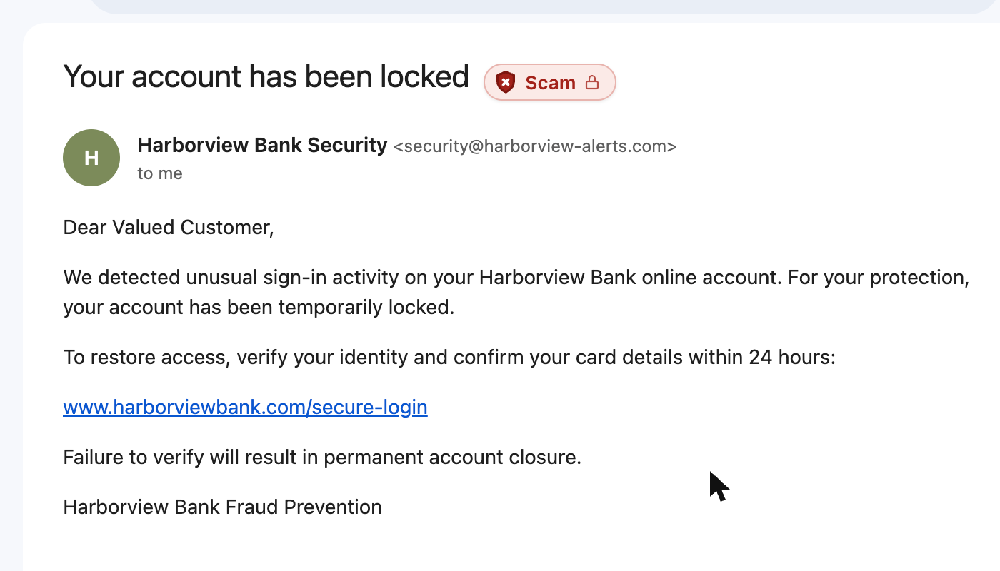

<p align="center">
  
</p>

<p align="center">
  <b>A private scam checker for Gmail, texts and screenshots.</b><br>
  On-device first with Gemini Nano, redacted cloud help only when it's needed, all through <b>Firebase AI Logic hybrid inference</b>.
</p>

<p align="center">
  <a href="https://chromewebstore.google.com/detail/scamouflage/bcebmomgjaikeclnakgkkbdjmihdejgm"><b>🧩 Add to Chrome</b></a> &nbsp;·&nbsp;
  <a href="https://scamouflage-37a72.web.app"><b>▶ Live web demo</b></a> &nbsp;·&nbsp;
  <a href="#testing-guide"><b>✅ Testing guide</b></a> &nbsp;·&nbsp;
  <a href="docs/DEVPOST.md"><b>📝 Project story</b></a>
</p>

<p align="center">
  
  &nbsp;
  
</p>
<p align="center">
  
</p>
<p align="center"><sub>Panel results are real Gemini Nano outputs on invented sample emails. The Gmail badge is shown on an unbranded mock that uses Gmail's page structure (<code>scripts/mail-mock.html</code>). Every brand shown is invented.</sub></p>

**Scamouflage** is a Chrome extension and web app that tells you, in plain words, whether an email, text or screenshot is a scam, and what to do next. It is built for the people scammers target most: **older adults, and the family members who look out for them.**

> **Value proposition.** Most scam checkers make you upload your inbox to someone's server. Scamouflage checks messages **on your own computer** with Chrome's built-in Gemini Nano, answers in **under a second**, and asks the cloud for help only when it must, **after removing your personal details**. You get one verdict, one reason and one next step, in words a frightened, non-technical reader can act on.

Built for **#BuildHybridAI 2026**, Web (Chrome) track. Runs on two platforms: the **Chrome extension** (published on the Chrome Web Store) and a **hosted web app** (Firebase Hosting) that runs the same panel and the same hybrid engine.

<br>

<p align="center"></p>

| | How | What you'll see |
|---|---|---|
| **1. No install** | Open the **[live web demo](https://scamouflage-37a72.web.app)** → tap a sample → **Check for scams** | A streamed verdict, the warning signs and the route chip (🔒 On-device or ☁️ Cloud · N hidden) |
| **2. The full extension** | **[Add to Chrome](https://chromewebstore.google.com/detail/scamouflage/bcebmomgjaikeclnakgkkbdjmihdejgm)** → open Gmail → click the Scamouflage icon → open any email | The shield badge next to the subject, the side panel verdict and inbox labels |
| **3. From source** | See [Run it yourself](#run-it-yourself) | Everything above, plus timings in the console |

The full step-by-step script for judges is in the **[Testing guide](#testing-guide)**.

<br>

<p align="center"></p>

Scams are a fast-growing crime, and older adults lose the most.

- In 2025, Americans aged **60 and over** filed **201,266** complaints with the FBI's Internet Crime Complaint Center and reported **$7.75 billion** in losses. That is up **59%** from 2024, the most of any age group, at an average of **$38,500** per person. ([FBI IC3 2025 Internet Crime Report](https://www.ic3.gov/AnnualReport/Reports/2025_IC3Report.pdf), pp. 6 and 44)
- **Phishing and spoofing** was the most-reported crime type of all in 2025, with **191,561** complaints. ([same report](https://www.ic3.gov/AnnualReport/Reports/2025_IC3Report.pdf), p. 7)
- The FTC received **3 million** fraud reports totalling **$15.9 billion** in reported losses in 2025. ([FTC, Mar 25 2026](https://www.ftc.gov/news-events/news/press-releases/2026/03/ftc-testifies-joint-economic-committee-agencys-efforts-combat-fraud))
- Older adults' reported fraud losses to the FTC grew from about **$600 million in 2020 to $2.4 billion in 2024**. Because most fraud goes unreported, the FTC estimates the real 2024 cost to older adults at **$10.1–81.5 billion**. ([FTC, *Protecting Older Consumers 2024–2025*](https://www.ftc.gov/system/files/ftc_gov/pdf/P144400-OlderAdultsReportDec2025.pdf), pp. 1–2)

**Why existing help falls short:** spam filters miss targeted scams, "is this a scam?" tools want your email on their server, and generic chatbots answer with paragraphs instead of a decision. The person most at risk needs an answer that is **private, instant and impossible to misread**, at the moment they open the message.

<br>

<p align="center"></p>

| Feature | What you see |
|---|---|
| **Shield badge in Gmail** | Open an email and a small shield appears next to the subject: *Checking… → Scam / Be careful / Looks safe*. It lives in a Shadow DOM, so Gmail's styles can't break it. |
| **One verdict, one reason, one action** | "**Scam.** Asks you to pay a fake delivery fee. *Don't click, reply, or pay. Delete it.*" The action button changes with the scam type: *What if I already paid?* for payment scams, *What if I already called them?* for call-this-number scams. |
| **Proof, not just a verdict** | Tap a warning sign to see the evidence: *Says harborviewbank.com · Really goes to harborview-verify.top*. The disguised link lights up in the email itself. |
| **Instant first answer** | Local "recon" rules (look-alike domains, link mismatches, gift cards, urgency, secrecy) run in about **1 ms** while the AI confirms. They're always shown as a cautious "Be careful?", never as a "Scam" verdict. |
| **Streaming verdict** | The verdict appears the moment the model writes it, about **0.8 s on-device**, then the reason and warning signs fill in. |
| **Inbox labels** | Emails you've opened keep their verdict in the inbox list. Unopened emails are never guessed at, so there are no false alarms from preview text. |
| **Paste & Screenshot** | Paste any text message or DM, or drop a screenshot. Screenshots are checked by the on-device multimodal model. |
| **Debrief** | "I already clicked / paid / shared my password, what now?" A streaming chat gives calm, numbered recovery steps and never blames the reader. |
| **Second opinion** | When the on-device model is unsure, one tap asks a stronger cloud model, with personal details removed. |
| **Tell my family** | Share a warning with a trusted person who joined with a family code. Only a short summary is shared, never the message. |
| **Made to be read** | A five-step text-size slider, light and dark themes, full keyboard and screen-reader support, reduced motion, and WCAG AA contrast everywhere (`npm run contrast`). Color is never the only signal: every verdict has a word and an icon too. |

<p align="center">
  
</p>

<br>

<p align="center"></p>

Hybrid inference isn't a fallback bolted on at the end. **Choosing the route is the privacy feature.** Every request is routed by what it contains, what the user asked for, and whether Gemini Nano is ready.


### Where each request runs, and why

| Request | Where | Firebase AI Logic call | Why |
|---|---|---|---|
| **Scan** (Nano ready) | **On-device** | `getGenerativeModel({ mode: ONLY_ON_DEVICE, onDeviceParams: { createOptions: text-only, promptOptions: { responseConstraint } } })` + `generateContentStream` | Private and free. `ONLY_ON_DEVICE`, not `PREFER_…`, guarantees the unredacted email *can't* be routed to the cloud. |
| **Scan** (Nano not ready) | Cloud, **redacted** | `mode: PREFER_ON_DEVICE`, `inCloudParams: { model, generationConfig: { responseMimeType: 'application/json', responseJsonSchema } }` | Works on any Chrome. The text is redacted *before* the call, so whichever route the SDK picks is private. |
| **Automatic checks** (email opened) | On-device only | same as row 1 | Opening an email never sends anything anywhere by itself. |
| **Cold start** (Nano still loading) | On-device **and** redacted cloud, **raced** | `ONLY_ON_DEVICE` + `ONLY_IN_CLOUD`, with `AbortSignal` | For checks the user asked for, with cloud help on. If Nano hasn't loaded yet, the backup starts after 0.3 s; once it has, only after 5 s (`hedge_ms`). The first route to stream a verdict wins and the other is cancelled. |
| **On-device failed** | Cloud, redacted | `ONLY_IN_CLOUD` | A verdict that already streamed is kept instead. A dropped connection is retried once. |
| **Second opinion** | Cloud, redacted | `ONLY_IN_CLOUD`, stricter prompt | Offered only when the on-device result is "Be careful" or below the confidence threshold. |
| **Screenshot** | On-device, multimodal | `expectedInputs: [text, image]` + `inlineData` | Images can't be redacted, so the cloud is used only if the user allows cloud help. |
| **Debrief** | Cloud, redacted | `startChat()` + `sendMessageStream` | Multi-turn chat isn't available on-device. |

The panel's **route chip** reports the SDK's `inferenceSource` honestly: **🔒 On-device**, or **☁️ Cloud · 4 hidden** (how many details were removed). Tap it for a plain-language explanation.

**Where to look in the code:** the engine is [`src/ai.js`](src/ai.js) (`getGenerativeModel` at line 39, the `scanEmail` race from line 217, `startDebrief` / `sendMessageStream` from line 420). `getAI` and App Check are set up in [`src/firebase.js`](src/firebase.js). The race is covered by 11 tests with a mocked SDK in [`test/routing.test.js`](test/routing.test.js).

<br>

<p align="center"></p>

The first prototype took **7.9–9.2 s** on-device for the sample scam, with nothing on screen until the end. Measuring showed that session creation was negligible (about 1 ms warm) and **output tokens dominated**. What changed:

1. **Tiny schema, verdict first:** `{ verdict, confidence, why (≤12 words), flags (≤3) }`. The UI derives the action from the verdict, so output went from about 1,000 to about 350 characters.
2. **Shrunk input:** quoted replies, forwarded history, signatures, legal footers and invisible characters are stripped. The body is capped at about 1,800 characters, and links are kept one per domain, at most 8, mismatched links first.
3. **Streaming + partial-JSON parsing** ([`src/core/partial-json.js`](src/core/partial-json.js)): the verdict renders the moment its string closes.
4. **Text-only sessions:** the SDK's default declares image input for every session. Text scans use `expectedInputs: [text]`, and only the screenshot model asks for images.
5. **A real warm-up:** creating a session doesn't load Nano's weights; a one-word prompt does. The panel warms the model as it opens, so a first-time user's model loads while they read onboarding. The Screenshot tab warms the image encoder.
6. **A hedge for cold starts:** if a check still finds Nano loading, a redacted cloud request races it (see the table above).
7. **Session cache** keyed by a content hash, so re-opening an email is instant.

| Measured (Gemini Nano, Chrome 158, Apple Silicon) | Before | After |
|---|---|---|
| Sample scam: verdict on screen | 7.9–9.2 s (no streaming) | **0.74–0.80 s** |
| Sample scam: complete result | 7.9–9.2 s | **2.7–2.9 s** |
| Long newsletter with a quoted thread: complete result | 3.0–6.2 s | **1.3–1.6 s** |
| Screenshot check: verdict on screen | – | **2.4 s** |
| Web demo, cloud route, fresh browser: verdict on screen | 1–4 s | **0.8–1.2 s** |
| Early recon warning signs | – | **~1 ms** |
| Re-opening a checked email | full re-scan | **instant (cache)** |

Set `localStorage['scamouflage.debug']='1'` in the panel to log timings like `⏱ scan (on_device) {"recon":1,"firstToken":602,"verdict":737,"total":2663,…}`.

<br>

<p align="center"></p>

- **On-device by default.** When Gemini Nano is available, the email is processed by Chrome's built-in model and never leaves the computer.
- **Redaction before any cloud request** ([`src/core/redact.js`](src/core/redact.js)): email addresses, phone numbers (US and international), card numbers (Luhn-checked), bank/IBAN and account numbers, SSNs, verification codes, names in greetings, street addresses, and URL query strings (tracking IDs, tokens). Sender **domains**, link **domains**, amounts and dates are kept, because they're the evidence. Covered by unit tests, including false-positive cases.
- **Automatic checks never use the cloud.** Cloud help runs only when you press a button, and can be turned off entirely (**Settings → Cloud help**), which makes Scamouflage on-device only.
- **The content script makes no network requests and runs no AI.** It reads the open email and talks only to the extension.
- **Family sharing stores a summary, never the email:** the verdict, a one-line reason, warning-sign labels, a redacted subject and the sender's domain. [`firestore.rules`](firestore.rules) enforces that shape, and only members can read it.
- **No ads, no analytics, nothing sold.** Results are cached only for the browser session (`chrome.storage.session`). Full policy: **[scamouflage-37a72.web.app/privacy](https://scamouflage-37a72.web.app/privacy)**.

<br>

<p align="center"></p>

| Product | Used for |
|---|---|
| **Firebase AI Logic** (Gemini Developer API) | Hybrid on-device/cloud scans, structured JSON output on both routes, streaming, the multimodal screenshot check, Debrief chat, the second opinion and the on-device model download (`initializeDeviceModel`). |
| **App Check** | Protects the AI Logic endpoint. The extension uses an App Check **debug token**, which the rules allow, because reCAPTCHA can't run on `chrome-extension://` pages. The web app uses **reCAPTCHA Enterprise**, and its build is checked so it never contains the debug token ([`scripts/check-web-build.mjs`](scripts/check-web-build.mjs)). |
| **Remote Config** | `cloud_model`, `max_body_chars`, `max_links`, `escalation_threshold`, `ondevice_timeout_ms`, `hedge_ms`, `prompt_version` and three feature flags. Speed, accuracy and features can be tuned without republishing. Cached values apply instantly, and new ones are fetched in the background. |
| **Authentication** | Anonymous sign-in for family sharing, via `firebase/auth/web-extension`, because MV3 extensions can't load remote code. |
| **Cloud Firestore** (Lite SDK) | Family circles and shared redacted reports, with rules that only let people add *themselves* to a circle and that validate every field of a report. |
| **Hosting** | The web app and landing page, with no-cache HTML so updates never strand an open tab. |

Auth and Firestore are lazy-loaded, so they cost nothing until someone opens Family.

<br>

<p align="center"></p>

[`src/samples.js`](src/samples.js) holds 18 realistic, **invented** messages: 11 scams of different types (delivery fee, bank lock, gift-card "boss", tech-support refund, romance/crypto, changed invoice details, lottery, password expiry, grandparent bail text, utility shut-off and more), 1 deliberately ambiguous sign-in alert, and 7 legitimate messages (newsletter, receipt, family note, pharmacy, bank statement, doctor reminder, a *real* security alert).

`npm run eval` runs them through the exact production prompt, redacted like the product. [`eval/ondevice.js`](eval/ondevice.js) runs the same prompts through Gemini Nano in Chrome.

| Path | Exact verdict | Scam/suspicious vs safe | Missed scams | False alarms | Time |
|---|---|---|---|---|---|
| **On-device Gemini Nano** | **16/18 (89%)** | **17/18 (94%)** | **0** | 1 | verdict 0.71 s · done 2.7 s (median) |
| Cloud `gemini-3.5-flash-lite` (redacted) | **17/18 (94%)** | **18/18 (100%)** | **0** | 0 | 1.1 s |
| Recon rules only (no AI) | 14/18 (78%) | 17/18 (94%) | 0 | 0 | ~1 ms |

Nano's one false alarm is "Be careful" on a genuine sign-in alert, which errs on the cautious side. The eval drove one prompt change: an explicit rule that a notice from a company's own domain that only points you to its official app or website is safe. That halved Nano's false alarms and left the cloud result unchanged. The recon rules were written alongside this set, so their score is optimistic. With 18 messages, treat these as smoke-test numbers, not a benchmark.

<br>

<p align="center"></p>

**Requirements:** Chrome desktop 139+, Node 20+.

1. **On-device AI:** current Chrome exposes Gemini Nano to extensions by default. The model downloads on first use, and Chrome needs about 22 GB of free disk space for it. For on-device **screenshot** checks, set `chrome://flags/#prompt-api-multimodal-input` to **Enabled** and restart. Without on-device AI, Scamouflage uses redacted cloud help.
2. **Build:**
   ```bash
   git clone https://github.com/vlww/Scamouflage.git && cd Scamouflage
   npm install
   cp .env.example .env.local   # paste your App Check debug token
   npm run build                # or: npm run dev (rebuilds on save, logs timings)
   ```
3. `chrome://extensions` → **Developer mode** → **Load unpacked** → choose `dist/`.
4. Open Gmail (reload tabs that were already open), click the Scamouflage icon and open an email. The first run walks you through a 3-step setup, including downloading the on-device model.

| Script | Does |
|---|---|
| `npm test` | 79 Vitest tests: redaction, cleanup, partial JSON, recon and the on-device/cloud race |
| `npm run lint` · `npm run contrast` | ESLint · WCAG contrast check of every color pair |
| `npm run eval` | The accuracy eval above (cloud route) |
| `npm run zip` · `npm run zip:judge` | Store build · judge build with Demo mode on |
| `npm run build:web` · `npm run deploy:web` | Web app build (checked for secrets) · deploy to Firebase Hosting |

<details>
<summary><b>Using your own Firebase project</b></summary>

1. Replace `src/firebase-config.js` with your web app config.
2. Firebase console → **AI Logic** → get started with the **Gemini Developer API** (or `npx -y firebase-tools@latest init ailogic`).
3. **App Check** → register the web app → **Manage debug tokens** → add a token and put it in `.env.local`. For the web app, add a reCAPTCHA Enterprise key to `.env.web`.
4. Family sharing: **Authentication → Sign-in method → Anonymous → Enable**, create a **Firestore** database, then `npx -y firebase-tools@latest deploy --only firestore:rules --project <id>`.
5. Optional, **Remote Config**: `npx -y firebase-tools@latest deploy --only remoteconfig --project <id>` publishes `remoteconfig.template.json` (the same defaults are built in).

> The debug token is compiled into `dist/`. Never commit `.env.local`.
</details>

<br>

<p align="center"></p>

### Testing guide

Everything is free, needs no account and works on any desktop Chrome.

**Option A, no install (2 minutes):** open **[scamouflage-37a72.web.app](https://scamouflage-37a72.web.app)**.
1. In the live demo, tap a sample (**Delivery fee**, **Bank lock**, **Boss gift cards**, **Tech support**, **Grandkid in trouble**, **Store receipt**) → **Check for scams**.
2. Tap a warning sign to see its evidence, then tap the route chip to see where the check ran.
3. Tap **What should I do?** for the Debrief chat.
4. **Screenshot** tab → drop [`docs/demo/sample-text-message.png`](docs/demo/sample-text-message.png).
5. **Family** → **Create a family code** → **Open invite link** in a private window → **Join**. Back in the first window, check a scam and tap **Tell my family**, then **Check for new warnings** in the private window.

**Option B, the full extension (5 minutes):**
1. **[Add to Chrome](https://chromewebstore.google.com/detail/scamouflage/bcebmomgjaikeclnakgkkbdjmihdejgm)**. To use the built-in samples, open **Settings** → turn on **Demo mode**.<br>
   *Or load it manually:* download `scamouflage.zip` from the [latest release](https://github.com/vlww/Scamouflage/releases/latest), unzip it, then `chrome://extensions` → **Developer mode** → **Load unpacked**. That build has Demo mode on.
2. Click **Set up on this computer** during onboarding (or in **Settings**) to download Gemini Nano. If your computer can't run it, everything still works through the redacted cloud route, and the route chip shows **☁️ Cloud**.
3. Open Gmail and open any email: the shield badge appears next to the subject, and the panel shows the verdict. Go back to the inbox: the email keeps its label.
4. **See hybrid inference switch routes:** set `chrome://flags/#optimization-guide-on-device-model` to **Disabled**, restart and check again. The chip changes from **🔒 On-device** to **☁️ Cloud · N hidden**. The other way round: with Nano on, turn off Wi-Fi and checks keep working.

<br>

<p align="center"></p>

**Built during the hackathon.** Everything in this repository was written during #BuildHybridAI 2026, starting with the first commit on Nov 24, 2026. No pre-existing code is included beyond the open-source libraries listed below. The commit history shows each milestone: engine and routing, speed, UI, family sharing, evals, web app, store release.

**Project layout**

```
src/ai.js            Firebase AI Logic engine: routing, the on-device/cloud race, streaming, Debrief
src/firebase.js      getAI + App Check (debug token in the extension, reCAPTCHA Enterprise on the web)
src/config.js        Remote Config
src/family.js        Auth + Firestore family sharing
src/core/            Pure logic: redaction, recon rules, input cleanup, partial JSON, prompts
src/sidepanel.js     The panel UI (shared by the extension and the web app)
public/content.js    Gmail content script: reads the open email, draws the badge and inbox labels
test/ · eval/        Unit tests · accuracy eval
```

**Credits and license.** [Apache 2.0](LICENSE). Open-source libraries: Firebase JS SDK, Vite, Vitest, [Lucide](https://lucide.dev) icons (ISC), Russo One font (SIL OFL 1.1, bundled locally). No third-party logos or trademarks appear in the UI, samples or demo assets: every brand in the samples is invented.
