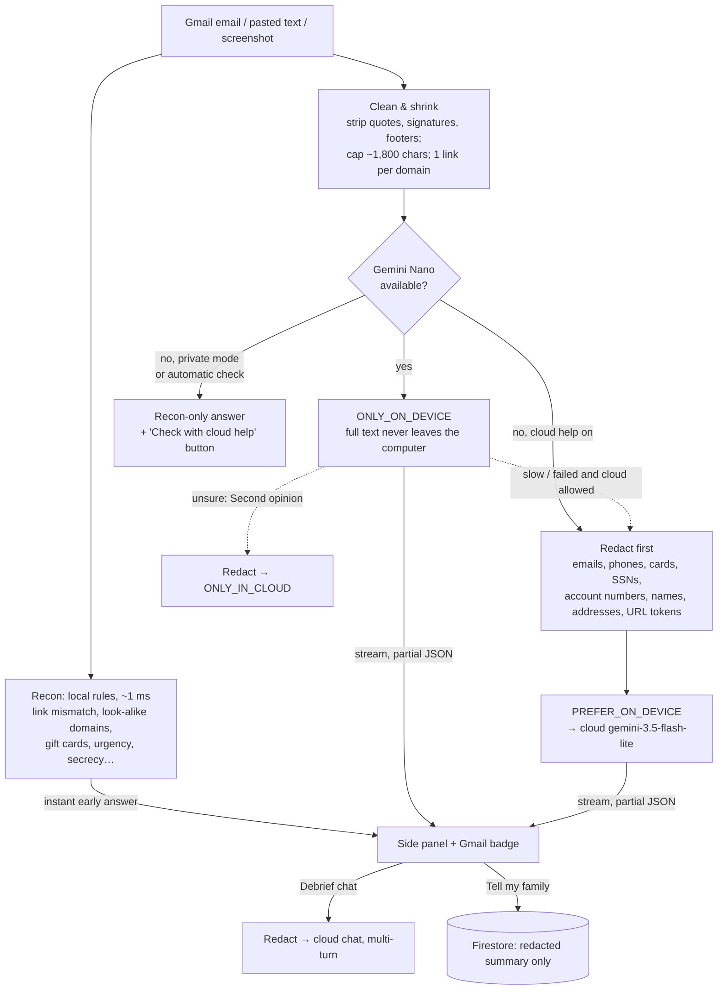

# Scamouflage

**Scams hide. We spot them.**

Scamouflage is a Chrome extension that checks the email you have open in Gmail, a message you paste, or a screenshot of a text or DM, and tells you in plain words whether it's a scam and what to do. The check runs **privately on your own computer** with Gemini Nano. The cloud steps in only when it's actually needed, and only after personal details are stripped out.

Built for **#BuildHybridAI 2026** (Web/Chrome track) with **Firebase AI Logic hybrid inference**.

<p align="center">
  
  
</p>

---

## The problem

Scams are a fast-growing crime, and older adults lose the most.

- In 2025, Americans aged **60 and over** filed **201,266** complaints with the FBI's Internet Crime Complaint Center and reported **$7.75 billion** in losses. That's up 59% from 2024, the most of any age group, at an average of **$38,500** per complainant. ([FBI IC3 2025 Internet Crime Report](https://www.ic3.gov/AnnualReport/Reports/2025_IC3Report.pdf), pp. 6 and 44)
- **Phishing/spoofing** was the most-reported crime type of all in 2025, with **191,561** complaints. ([same report](https://www.ic3.gov/AnnualReport/Reports/2025_IC3Report.pdf), p. 7)
- The FTC received **3 million** fraud reports totalling **$15.9 billion** in reported losses in 2025. ([FTC, Mar 25 2026](https://www.ftc.gov/news-events/news/press-releases/2026/03/ftc-testifies-joint-economic-committee-agencys-efforts-combat-fraud))
- Older adults' reported fraud losses to the FTC grew from about **$600 million in 2020 to $2.4 billion in 2024**. Because most fraud goes unreported, the FTC estimates the real 2024 cost to older adults at **$10.1–81.5 billion**. ([FTC, *Protecting Older Consumers 2024–2025*](https://www.ftc.gov/system/files/ftc_gov/pdf/P144400-OlderAdultsReportDec2025.pdf), pp. 1–2)

Most "is this a scam?" tools make you upload your email to someone's server, which is a privacy problem of its own, especially for the people most at risk.

## Who it's for

Everyday people, and especially **older adults and the family members who look out for them**. Everything is designed for a stressed, non-technical reader:

- **Verdict → one-line why → one clear action.** "Scam. Asks you to pay a fake delivery fee. Don't click, reply, or pay. Delete it."
- Plain verdict words (**Scam / Be careful / Looks safe**) shown with color, an icon *and* a word, never color alone.
- Large-text mode, full keyboard support, screen-reader labels, reduced-motion support, and WCAG AA contrast in light and dark themes (checked by `npm run contrast`).
- **Debrief** answers "I already clicked / paid / shared my password, what now?" with concrete recovery steps.
- **Tell my family** shares a *redacted* summary with a trusted person.

## What it does

| Feature | What you see |
|---|---|
| **In-Gmail badge** | A small shield next to the open email's subject: *Checking… → Scam / Be careful / Looks safe*. Click it to open the panel. Shadow DOM, so Gmail's CSS can't break it. |
| **Instant answer** | Local "recon" rules run in about 1 ms and show early warning signs while the AI confirms. |
| **Streaming verdict** | The verdict appears as soon as the model writes it (about 0.8 s on-device), then the reason and warning signs fill in. |
| **Pre-scan + cache** | With the panel open, emails are checked as you open them. Results are cached for the session, so re-opening an email is instant (even with the panel closed). |
| **Evidence** | Tap a warning sign to see the proof ("Says: mybank.com · Really goes to: mybank-verify.top"). In Gmail, the offending link is highlighted on the page. |
| **Screenshot check** | Drop or paste a screenshot of a text message, DM or pop-up. Multimodal, on-device. |
| **Second opinion** | When the on-device verdict is unsure, ask a cloud model (redacted) with one tap, or turn it on automatically. |
| **Debrief** | A streaming cloud chat with quick replies: *Is this real? · I already clicked · I already paid · I shared my password · How do I report it?* |
| **Tell my family** | Share the verdict and a redacted summary with family who join with a code, or copy a ready-to-send message. |
| **Toolbar badge** | The extension icon shows `!` / `?` / `✓` for the current email. |

## How the hybrid inference works



### Where each request runs, and why

| Request | Where | Firebase AI Logic call | Why |
|---|---|---|---|
| **Scan** (Nano ready) | **On-device** | `getGenerativeModel({ mode: ONLY_ON_DEVICE, onDeviceParams: { createOptions: text-only, promptOptions: { responseConstraint } } })` + `generateContentStream` | Private and free. `ONLY_ON_DEVICE` (not `PREFER_…`) guarantees the unredacted email can't be routed to the cloud. |
| **Scan** (Nano not ready) | Cloud, **redacted** | `mode: PREFER_ON_DEVICE`, `inCloudParams: { model, generationConfig: { responseMimeType: 'application/json', responseJsonSchema } }` | Works on any Chrome. Text is redacted *before* the call, so either route the SDK picks is private. |
| **Automatic checks** (email opened) | On-device only | same as row 1 | Opening an email never sends anything to the cloud by itself. |
| **Scan timed out / failed on-device** | Cloud, redacted | `ONLY_IN_CLOUD` | Only if cloud help is on. Labelled "On-device was slow" in Details. A verdict that already streamed is kept instead. |
| **Second opinion** | Cloud, redacted | `ONLY_IN_CLOUD`, stricter prompt | Only when the on-device result is "Be careful" or under the confidence threshold. |
| **Screenshot** | On-device (multimodal) | `expectedInputs: [text, image]` + `inlineData` (JPEG/PNG) | Images can't be redacted, so cloud is used only if cloud help is on. Other formats are converted to PNG first. |
| **Debrief** | Cloud, redacted | `startChat()` + `sendMessageStream` | Multi-turn chat isn't supported on-device. |

The panel's **route chip** always tells the truth from the SDK's `inferenceSource`: **🔒 On-device**, or **☁️ Cloud · 4 hidden** (how many details were redacted). Tap it for a plain-language explanation.

### Making Nano fast

The original prototype took **7.9–9.2 s** for the sample scam on-device, with nothing on screen until the end. Measuring showed session creation was negligible (about 1 ms warm) and **output tokens dominated**. What changed:

1. **Tiny schema, verdict first**: `{ verdict, confidence, why (≤12 words), flags (≤3, ≤10 words) }`. The old `summary` and `advice` fields are gone; the UI derives the action from the verdict. Output went from about 1,000 to about 350 chars.
2. **Shrunk input**: quoted replies, forwarded history, signatures, legal footers and invisible characters are stripped, the body is capped at about 1,800 chars, and links are kept one per domain, max 8 (mismatched links first).
3. **Streaming + partial-JSON parsing** (`src/core/partial-json.js`): the verdict renders the moment its string closes.
4. **Text-only sessions**: the SDK's default declares image input for every session. Text scans now use `expectedInputs: [text]`, and only the screenshot model asks for images.
5. **Instant recon** answer at about 1 ms, plus a **warm-up** session per panel open so the first check doesn't pay the cold start.
6. **Pre-scan + session cache** keyed by a content hash.

| Measured on-device (Gemini Nano, Chrome 158, Apple Silicon) | Before | After |
|---|---|---|
| Sample scam: time until the verdict is on screen | 7.9–9.2 s (no streaming) | **0.74–0.80 s** |
| Sample scam: complete result | 7.9–9.2 s | **2.7–2.9 s** |
| Long newsletter with quoted thread: complete result | 3.0–6.2 s | **1.3–1.6 s** |
| Early recon warning signs on screen | – | **~1 ms** |
| Re-opening an already checked email | full re-scan | **instant (cache)** |

Timings are logged in development builds (`npm run dev`) as `[Scamouflage] ⏱ scan (on_device) {"recon":1,"firstToken":602,"verdict":737,"total":2663,…}`. Set `localStorage['scamouflage.debug']='1'` in the panel to see them in a production build.

## Privacy model

- **On-device by default.** When Gemini Nano is available, the email is processed by Chrome's built-in model and never leaves the computer.
- **Redaction before any cloud request** (`src/core/redact.js`): email addresses, phone numbers (US and international), card numbers (Luhn-checked), bank/IBAN and account numbers, SSNs, verification codes and long reference numbers, names in greetings, street addresses, and URL query strings and fragments (tracking IDs, tokens). Sender **domains**, link **domains**, amounts and dates are kept because they're the evidence. Covered by 36 unit tests including false-positive cases.
- **Automatic checks never use the cloud.** Cloud help only runs when you press a button, and can be switched off entirely (**Settings → Cloud help**), which makes Scamouflage on-device only.
- **The content script makes no network requests and runs no AI.** It reads the open email and talks only to the extension.
- **Family sharing stores a summary, not the email**: verdict, one-line reason, warning-sign labels, a redacted subject and the sender's domain. Firestore rules enforce the shape (see `firestore.rules`).
- Nothing is sold or used for ads. Results are cached only for the browser session (`chrome.storage.session`).

## Firebase products used

| Product | Used for |
|---|---|
| **Firebase AI Logic** (Gemini Developer API) | Hybrid on-device/cloud scan, structured JSON output both ways, streaming, multimodal screenshot check, Debrief chat |
| **App Check** | Protects the AI Logic endpoint. reCAPTCHA can't run on `chrome-extension://` pages, so the extension uses an App Check **debug token**, which the hackathon rules allow. |
| **Remote Config** | `cloud_model`, `max_body_chars`, `max_links`, `escalation_threshold`, `ondevice_timeout_ms`, `prompt_version`, `feature_image_check`, `feature_auto_scan`, `feature_family`: tune speed/accuracy and switch features without republishing. Cached values apply instantly; new ones are fetched in the background. |
| **Authentication** | Anonymous sign-in via `firebase/auth/web-extension` (MV3 can't load remote code) for family sharing |
| **Cloud Firestore** (Lite SDK) | Family circles and shared redacted reports, with tight security rules |

Auth and Firestore are lazy-loaded, so they don't slow down the panel until someone uses Family.

## Accuracy (eval set)

`src/samples.js` holds 18 realistic, **invented** messages (all brands, people, domains and numbers are made up). There are 11 scams of different types (delivery fee, bank lock, gift-card "boss", tech-support refund, romance/crypto, changed invoice bank details, lottery, password expiry, grandparent bail text, utility shut-off), 1 ambiguous sign-in alert, and 7 legitimate messages (newsletter, receipt, family note, pharmacy, bank statement, doctor reminder, a *real* security alert).

`npm run eval` runs them through the exact production prompt (redacted, like the product). `eval/ondevice.js` runs the same prompts through Gemini Nano in Chrome.

| Path | Exact verdict | Scam/suspicious vs safe | Missed scams | False alarms | Avg time |
|---|---|---|---|---|---|
| **On-device Gemini Nano** (prompt v2) | **16/18 (89%)** | **17/18 (94%)** | 0 | 1 | verdict 0.71 s · done 2.7 s (median) |
| Cloud `gemini-3.5-flash-lite` (prompt v2, redacted) | **17/18 (94%)** | **18/18 (100%)** | 0 | 0 | 1.1 s |
| Recon rules only (no AI) | 14/18 (78%) | 17/18 (94%) | 0 | 0 | ~1 ms |

Both models call the deliberately ambiguous sign-in alert "scam" rather than "suspicious". Nano's one false alarm is "Be careful" on a genuine sign-in alert, the cautious direction. The eval drove one prompt change: an explicit rule that a notice from a company's own domain that only points you to its official app or website is safe. That cut Nano's false alarms from 2 to 1 and left the cloud result unchanged. The recon rules were written alongside this set, so their score is optimistic. They are a fast first answer, not the judge. With only 18 messages, treat these as smoke-test numbers, not a benchmark.

## Run it locally

Requirements: Chrome desktop 139+, Node 20+.

1. On-device AI: current Chrome exposes Gemini Nano to extensions by default (the model downloads on first use; Chrome requires about 22 GB of free disk space). For on-device **screenshot** checks, set `chrome://flags/#prompt-api-multimodal-input` (named `#prompt-api-for-gemini-nano-multimodal-input` in some versions) to **Enabled** and restart. Without on-device AI, Scamouflage uses redacted cloud help.
2. Build:
   ```bash
   git clone https://github.com/vlww/Scamouflage.git && cd Scamouflage
   npm install
   cp .env.example .env.local   # paste your App Check debug token
   npm run build                # or: npm run dev (rebuilds on save, logs timings)
   ```
3. `chrome://extensions` → **Developer mode** → **Load unpacked** → choose `dist/`.
4. Open Gmail (reload Gmail tabs that were already open), click the Scamouflage icon, and open an email. The first run walks you through a 3-step setup, including downloading the on-device model.

Other scripts: `npm test` (Vitest, 68 tests) · `npm run lint` · `npm run contrast` (WCAG check) · `npm run eval` · `npm run zip` (builds `scamouflage.zip`).

### Using your own Firebase project

1. Replace `src/firebase-config.js` with your web app config.
2. Firebase console → **AI Logic** → get started with the **Gemini Developer API** (or `npx -y firebase-tools@latest init ailogic`).
3. **App Check** → register the web app → **Manage debug tokens** → add a token and put it in `.env.local`.
4. For family sharing: **Authentication → Sign-in method → Anonymous → Enable**, create a **Firestore** database, and deploy the rules: `npx -y firebase-tools@latest deploy --only firestore:rules --project <id>` (a `firebase.json` is included).
5. Optional: **Remote Config** parameters listed above (defaults are built in).

> The debug token is compiled into `dist/`. Never commit `.env.local`, and revoke the token after judging.

## Testing for judges

1. Download `scamouflage.zip` from the Devpost submission and unzip it. It includes a working App Check debug token.
2. `chrome://extensions` → **Developer mode** → **Load unpacked** → select the unzipped folder.
3. For on-device inference, click **Set up on this computer** during onboarding (or in **Settings**) to download Gemini Nano. For on-device screenshot checks also enable `chrome://flags/#prompt-api-multimodal-input` and restart. If your machine can't run Nano, everything still works through the redacted cloud path, and the route chip shows **☁️ Cloud**.
4. **No Gmail needed:** open the panel → **Paste** → tap a sample (*Delivery fee*, *Bank lock*, *Boss gift cards*, *Tech support*, *Grandkid in trouble*, *Store receipt*) → **Check for scams**.
5. Try **What if I already clicked?**, tap a warning sign to see its evidence, tap the route chip, and drop a screenshot into **Screenshot**.
6. To see the hybrid fallback: set `chrome://flags/#optimization-guide-on-device-model` to **Disabled**, restart, and check again. The route chip switches from **🔒 On-device** to **☁️ Cloud · N hidden**. The other way round: with Nano on, turn off Wi-Fi and checks keep working on-device.

## Built during the hackathon

Everything in this repository was written during #BuildHybridAI 2026. The first commit (Nov 24, 2026) is the initial prototype scaffold; the commit history shows each milestone (speed, engine and routing, UI, family sharing, evals, docs).

## Credits & license

[Apache 2.0](LICENSE). Icons: [Lucide](https://lucide.dev) (ISC). Wordmark font: Saira Stencil One (SIL OFL 1.1), bundled locally. No third-party logos or trademarks appear in the UI, samples or demo assets: every brand in the samples is invented.
