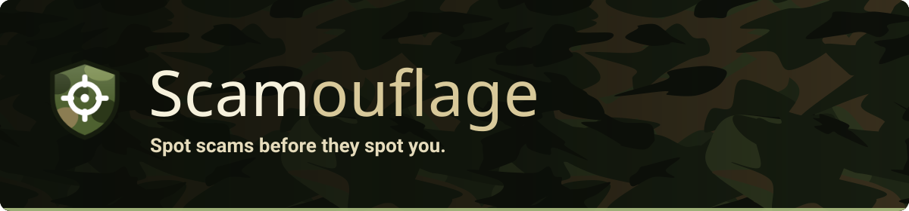
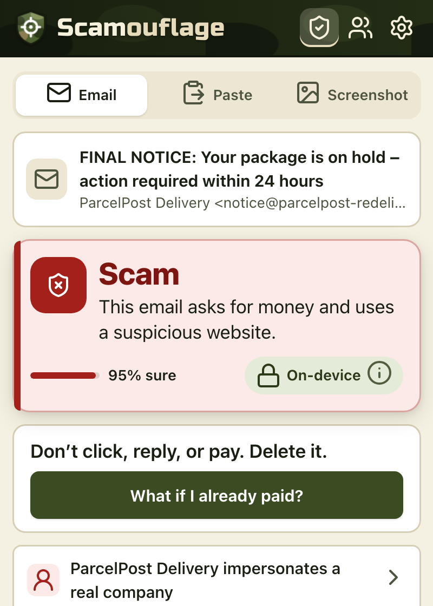
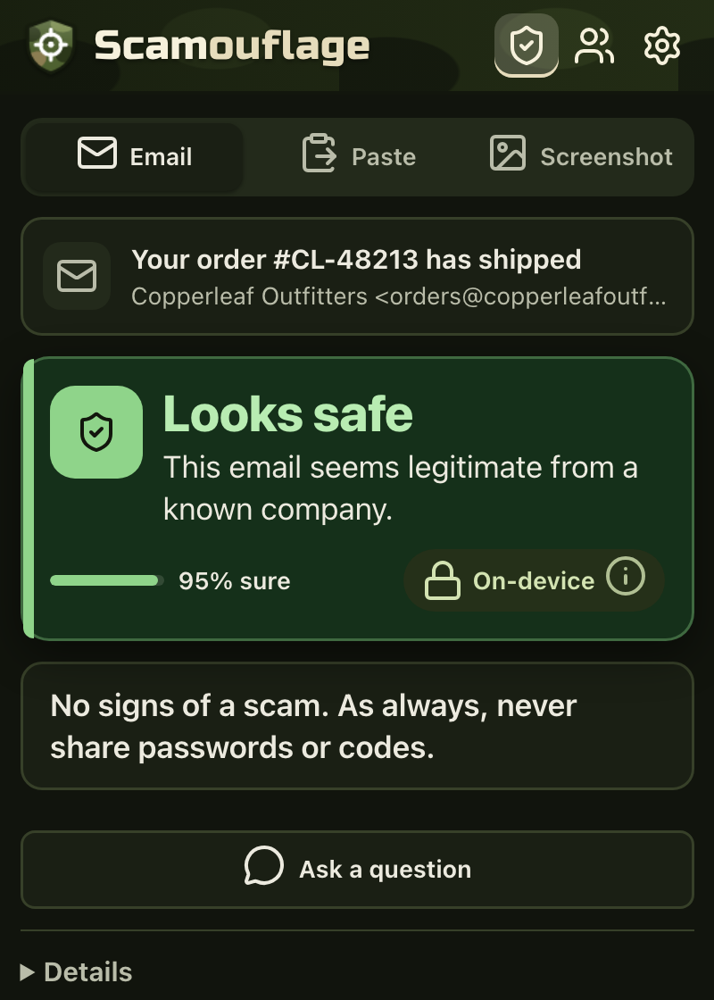
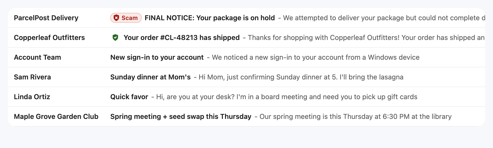
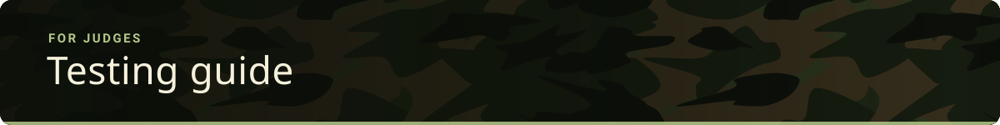

<p align="center">
  
</p>

<p align="center">
  <a href="https://chromewebstore.google.com/detail/scamouflage/bcebmomgjaikeclnakgkkbdjmihdejgm"><b>🧩 Add to Chrome</b></a> &nbsp;·&nbsp;
  <a href="https://scamouflage-37a72.web.app"><b>▶ Live web demo</b></a> &nbsp;·&nbsp;
  <a href="#testing-guide"><b>✅ Testing guide</b></a>
</p>

---

<p align="center"></p>

## Overview

**Scamouflage is a Chrome extension that checks your emails for scams, right inside Gmail.** Open an email and a small shield appears next to the subject: **Scam**, **Be careful** or **Looks safe**. Click it and a side panel explains why in one plain sentence and tells you exactly what to do next. You can also paste a text message or drop in a screenshot.

The checking happens **on your own computer**, using Gemini Nano, the AI model built into Chrome. If your computer can't run it, Scamouflage asks Gemini in the cloud for help instead, but only after it removes your personal details. Both routes go through **Firebase AI Logic hybrid inference**.

It's made for the people scammers target most: **elderly people, and the family members who look out for them.**

<p align="center">
  
  &nbsp;
  
</p>
<p align="center">
  
</p>

### Value proposition

- **Private.** Your messages are checked on your computer, not uploaded to a stranger's server.
- **Instant.** The verdict shows up in under a second, in the inbox, at the moment you'd otherwise click.
- **Impossible to misread.** One word, one reason, one next step. No jargon, no percentages to puzzle over.
- **Helpful after the fact.** Already clicked or paid? It walks you through what to do now, calmly.
- **Free, and works anywhere.** One click from the Chrome Web Store. No account. If your computer can't run the on-device model, it still works.

Scamouflage runs as a **Chrome extension** ([Chrome Web Store](https://chromewebstore.google.com/detail/scamouflage/bcebmomgjaikeclnakgkkbdjmihdejgm)) and as a **web app** ([live demo](https://scamouflage-37a72.web.app)) that runs the same panel and the same AI engine. Built for **#BuildHybridAI 2026** (Web/Chrome track), starting Nov 23, 2026.

---

<p align="center"></p>

## Try it in 60 seconds

There are three ways to try Scamouflage. The Chrome extension is the full experience inside Gmail. The web demo is the fastest and needs no install.

| | How | What you'll see |
|---|---|---|
| **The real thing** | **[Add to Chrome](https://chromewebstore.google.com/detail/scamouflage/bcebmomgjaikeclnakgkkbdjmihdejgm)**, open Gmail, click the Scamouflage icon, open an email | The shield next to the subject, the side panel, and labels in your inbox |
| **No install** | Open the **[live web demo](https://scamouflage-37a72.web.app)**, tap a sample, press **Check for scams** | The verdict streaming in, its warning signs, and a chip showing where the check ran |
| **From source** | Follow [Run it yourself](#run-it-yourself) | All of the above, plus timing logs |

Step-by-step instructions for judges are in the **[Testing guide](#testing-guide)**.

---

<p align="center"></p>

## The problem

<p align="center"></p>

Scams are growing fast, and older adults lose the most:

- Americans **60 and over** reported **$7.75 billion** in losses to the FBI in 2025. That's **59% more** than the year before, more than any other age group, and **$38,500** per person on average. ([FBI IC3 2025 report](https://www.ic3.gov/AnnualReport/Reports/2025_IC3Report.pdf))
- **Phishing** was the most-reported crime of all, with **191,561** complaints. ([FBI IC3 2025 report](https://www.ic3.gov/AnnualReport/Reports/2025_IC3Report.pdf))
- The FTC logged **3 million** fraud reports and **$15.9 billion** in losses in 2025. ([FTC, Mar 25 2026](https://www.ftc.gov/news-events/news/press-releases/2026/03/ftc-testifies-joint-economic-committee-agencys-efforts-combat-fraud))
- Most fraud is never reported. The FTC estimates the real cost to older adults in 2024 at **$10.1–81.5 billion**. ([FTC, *Protecting Older Consumers 2024–2025*](https://www.ftc.gov/system/files/ftc_gov/pdf/P144400-OlderAdultsReportDec2025.pdf))

The tools people have today don't fit the moment:

| Option | The catch |
|---|---|
| Spam filters | Built for bulk spam. A targeted "your package is on hold" email still lands in the inbox. |
| Scam-checker websites | You have to forward or upload the email, which is its own privacy risk. |
| General AI chatbots | You have to copy the message over, and you get paragraphs of "it depends" instead of a decision. |
| **Scamouflage** | **Checks the email where you're reading it, privately, and gives you one clear answer.** |

---

<p align="center"></p>

## What it does

Scamouflage shows up in two places: a small badge inside Gmail, and a side panel that explains the result. Most of the time the badge is all you need. The panel is there when you want to know why, or what to do next.

| Feature | What you get |
|---|---|
| 🛡️ **Shield in Gmail** | Open an email and a badge appears next to the subject: *Checking… → Scam / Be careful / Looks safe*. |
| 💬 **One clear answer** | "**Scam.** Asks you to pay a fake delivery fee. *Don't click, reply, or pay. Delete it.*" |
| 🔍 **Proof you can see** | Tap a warning sign: *Says harborviewbank.com · Really goes to harborview-verify.top*. The fake link lights up in the email. |
| ⚡ **Instant first look** | Built-in rules spot look-alike links, gift-card requests and pressure tactics in about 1 ms while the AI confirms. They only ever say "Be careful?", never "Scam". |
| 📥 **Inbox labels** | Emails you've opened keep their verdict in the inbox list. Unopened emails are never guessed at. |
| 📋 **Texts and screenshots** | Paste any message, or drop in a screenshot of a text or DM. |
| 🆘 **"I already clicked"** | The Debrief chat gives calm, numbered recovery steps. The button adapts: *What if I already paid?* for payment scams, *What if I already called them?* for phone scams. |
| 🔁 **Second opinion** | When the on-device answer is unsure, one tap asks a stronger cloud model. |
| 👪 **Tell my family** | Share a warning with someone you trust. They see a short summary, never the email itself. |
| 🔤 **Easy to read** | Text-size slider, light and dark themes, keyboard and screen-reader support, and AA contrast everywhere. Every verdict has a word and an icon, never color alone. |

<p align="center">
  
</p>

---

<p align="center"></p>

## Hybrid inference with Firebase AI Logic

Hybrid inference is what makes Scamouflage private. **Deciding where each check runs *is* the privacy model.** Every request goes through Firebase AI Logic, and its route depends on what's in it, what you asked for, and whether Gemini Nano is ready.

<p align="center"></p>

| What's happening | Where it runs | Firebase AI Logic setup | Why |
|---|---|---|---|
| **Checking an email** (Nano ready) | 🔒 On your computer | `InferenceMode.ONLY_ON_DEVICE`, JSON schema via `onDeviceParams.promptOptions.responseConstraint`, `generateContentStream` | The full email can't reach the cloud, by design. |
| **Checking an email** (no Nano) | ☁️ Cloud, after redaction | `PREFER_ON_DEVICE`, JSON schema via `inCloudParams.generationConfig.responseJsonSchema` | Works on any Chrome. Personal details are removed *before* the call. |
| **Automatic check** (you opened an email) | 🔒 On your computer only | same as the first row | Opening an email never sends anything anywhere by itself. |
| **Nano is still loading** | 🔒 + ☁️ Both start at once, the first answer is used | `ONLY_ON_DEVICE` and a redacted `ONLY_IN_CLOUD` backup, cancelled with an `AbortSignal` | Right after Chrome starts, Nano can take 20+ seconds to load. The other check is cancelled. |
| **Second opinion** | ☁️ Cloud, redacted | `ONLY_IN_CLOUD`, stricter prompt | Only offered when the on-device answer is unsure. |
| **Screenshot** | 🔒 On your computer | `expectedInputs: [text, image]`, `inlineData` | Images can't be redacted, so they only go to the cloud if you allow it. |
| **Debrief chat** | ☁️ Cloud, redacted | `startChat()` + `sendMessageStream` | Multi-turn chat isn't available on-device. |
| **Model download** | 🔒 | `initializeDeviceModel` with a progress bar | Started from a button in onboarding. |

Every result shows a **route chip** read from the SDK's `inferenceSource`: **🔒 On-device**, or **☁️ Cloud · 4 hidden** (how many personal details were removed). What you see is what actually ran.

**Where it is in the code:** [`src/ai.js`](src/ai.js) imports `firebase/ai` and calls `getGenerativeModel` (line 39), `generateContentStream` (line 175), the on-device/cloud race in `scanEmail` (from line 217), and `startChat` / `sendMessageStream` (lines 423 and 436). [`src/firebase.js`](src/firebase.js) sets up `getAI` and App Check. The race is tested against a mocked SDK in [`test/routing.test.js`](test/routing.test.js).

---

<p align="center"></p>

## Built for speed

The first version took about **9 seconds** to check an email on-device, and nothing showed up until the very end. Measuring showed that starting the model took about 1 ms. **Nearly all the time went into the words the model wrote**, so the fix was to have it write less and show its answer sooner:

1. **A tiny answer format, verdict first:** `{ verdict, confidence, why, flags }`. The app works out the advice from the verdict, so the model writes about a third as much.
2. **A smaller input:** quoted replies, signatures and legal footers are stripped, the body is capped at about 1,800 characters, and only one link per website is kept.
3. **Streaming:** a small parser reads the answer as it's written, so the verdict appears the moment it's ready.
4. **Text-only sessions:** the SDK sets up image input by default. Text checks skip it.
5. **A real warm-up:** creating a session doesn't load the model, but a one-word prompt does. The panel warms Nano up when it opens.
6. **A race for cold starts:** if Nano is still loading, a redacted cloud request runs alongside it.
7. **A cache:** re-opening an email you've already checked is instant.

| Measured (Gemini Nano, Chrome 158, Apple Silicon) | Before | After |
|---|---|---|
| Sample scam: verdict on screen | 7.9–9.2 s | **0.74–0.80 s** |
| Sample scam: full result | 7.9–9.2 s | **2.7–2.9 s** |
| Long newsletter with a reply thread | 3.0–6.2 s | **1.3–1.6 s** |
| Screenshot: verdict on screen | – | **2.4 s** |
| Web demo, cloud route, fresh browser | 1–4 s | **0.8–1.2 s** |
| Quick-rule warning signs | – | **~1 ms** |
| Re-opening a checked email | full re-check | **instant** |

To see timings yourself, run `localStorage['scamouflage.debug']='1'` in the panel's console.

---

<p align="center"></p>

## Private by design

- **On your computer by default.** When Gemini Nano is available, your email never leaves your computer.
- **Personal details removed before anything is sent** ([`src/core/redact.js`](src/core/redact.js)): email addresses, phone numbers, card numbers, bank and account numbers, SSNs, codes, names in greetings, street addresses and tracking parts of links. The clues are kept, like the sender's domain, link domains and amounts, because they're how you spot a scam.
- **Automatic checks never use the cloud.** The cloud only helps when you press a button, and you can switch it off in **Settings → Cloud help**.
- **The Gmail script never goes online.** It reads the open email and only talks to the extension.
- **Family sharing stores a summary, not the email.** [`firestore.rules`](firestore.rules) enforces that, and only family members can read it.
- **No ads, no analytics, nothing sold.** Full policy: **[scamouflage.xyz/privacy](https://scamouflage-37a72.web.app/privacy)**.

---

<p align="center"></p>

## The Firebase stack

Firebase AI Logic does all the AI work. The other Firebase products keep it secure, let it be tuned without a new release, and power family sharing.

| Product | What it does in Scamouflage |
|---|---|
| **Firebase AI Logic** | Every AI call: on-device and cloud checks, structured answers, streaming, screenshot checks, the Debrief chat, second opinions and the on-device model download. |
| **App Check** | Protects the AI endpoint. The extension uses a debug token, which the hackathon allows, because reCAPTCHA can't run inside extensions. The web app uses reCAPTCHA Enterprise, and a build check makes sure the debug token never ends up on the website. |
| **Remote Config** | Tunes the engine without a new release: cloud model, input limits, the "unsure" threshold, timeouts, the cold-start race delay, the prompt version and feature switches. |
| **Authentication** | Anonymous sign-in for family sharing, with no email or password. |
| **Cloud Firestore** | Family groups and shared warnings, with rules that only let you add *yourself* to a family and check every field of a warning. |
| **Hosting** | The web demo and landing page. |

---

<p align="center"></p>

## Accuracy

The accuracy test uses 18 realistic, **made-up** messages ([`src/samples.js`](src/samples.js)): 11 scams (fake delivery fees, bank lockouts, gift-card "boss" requests, tech-support refunds, romance and crypto, changed invoice details, lottery wins, grandparent bail texts and more), 1 deliberately borderline sign-in alert, and 7 genuine messages, including a real security alert. `npm run eval` runs them through the exact prompt the product uses.

| Route | Exact verdict | Scam vs. safe | Missed scams | False alarms | Speed |
|---|---|---|---|---|---|
| **On-device Gemini Nano** | **16/18** | **17/18** | **0** | 1 | verdict in 0.71 s |
| Cloud, redacted | **17/18** | **18/18** | **0** | 0 | 1.1 s |
| Quick rules only, no AI | 14/18 | 17/18 | 0 | 0 | ~1 ms |

Nano's one false alarm was a cautious "Be careful" on a genuine sign-in alert. The eval led to one prompt fix (a notice from a company's own website that only points you to its official app is safe), which halved Nano's false alarms. Eighteen messages is a smoke test, not a benchmark.

---

<p align="center"></p>

## Run it yourself

**You need:** desktop Chrome 139 or newer, and Node 20 or newer.

1. **On-device AI:** Chrome downloads Gemini Nano the first time it's used (it needs about 22 GB of free disk space). For on-device screenshot checks, turn on `chrome://flags/#prompt-api-multimodal-input` and restart. Without Nano, Scamouflage uses the redacted cloud route.
2. **Build it:**
   ```bash
   git clone https://github.com/vlww/Scamouflage.git && cd Scamouflage
   npm install
   cp .env.example .env.local   # paste your App Check debug token
   npm run build                # or: npm run dev (rebuilds on save, logs timings)
   ```
3. Open `chrome://extensions`, turn on **Developer mode**, click **Load unpacked** and choose `dist/`.
4. Open Gmail, click the Scamouflage icon and open an email. The first run walks you through a 3-step setup.

| Command | What it does |
|---|---|
| `npm test` | 79 tests: redaction, quick rules, cleanup, streaming parser and the on-device/cloud race |
| `npm run lint` · `npm run contrast` | Code checks · checks every color pair meets WCAG contrast |
| `npm run eval` | The accuracy test above |
| `npm run zip` · `npm run zip:judge` | Store build · build with Demo mode on |
| `npm run build:web` · `npm run deploy:web` | Build the web app (checked for secrets) · deploy it to Firebase Hosting |

<details>
<summary><b>Using your own Firebase project</b></summary>

1. Put your web app config in `src/firebase-config.js`.
2. Firebase console → **AI Logic** → set up the **Gemini Developer API**.
3. **App Check** → register the app → **Manage debug tokens** → add one and put it in `.env.local`. For the web app, put a reCAPTCHA Enterprise key in `.env.web`.
4. For family sharing: enable **Anonymous** sign-in, create a **Firestore** database, then run `npx -y firebase-tools@latest deploy --only firestore:rules --project <id>`.
5. Optional: `npx -y firebase-tools@latest deploy --only remoteconfig --project <id>` publishes the Remote Config defaults.

> The debug token is built into `dist/`. Never commit `.env.local`.
</details>

---

<p align="center"></p>

## Testing guide

Everything is free and needs no account. Any desktop Chrome works.

**Option A: no install (2 minutes).** Open **[scamouflage.xyz](https://scamouflage-37a72.web.app)**.
1. In the live demo, tap a sample (**Delivery fee**, **Bank lock**, **Boss gift cards**, **Tech support**, **Grandkid in trouble**, **Store receipt**) and press **Check for scams**.
2. Tap a warning sign to see the proof. Tap the route chip to see where the check ran.
3. Tap **What should I do?** to try the Debrief chat.
4. In the **Screenshot** tab, drop in [`docs/demo/sample-text-message.png`](docs/demo/sample-text-message.png).
5. **Family:** tap **Create a family code**, then **Open invite link** in a private window and **Join**. Back in the first window, check a scam and tap **Tell my family**. In the private window, tap **Check for new warnings**.

**Option B: the full extension (5 minutes).**
1. **[Add to Chrome](https://chromewebstore.google.com/detail/scamouflage/bcebmomgjaikeclnakgkkbdjmihdejgm)**. For the built-in samples, open **Settings** and turn on **Demo mode**.<br>
   *Or load it by hand:* download `scamouflage.zip` from the [latest release](https://github.com/vlww/Scamouflage/releases/latest), unzip it, and use **Load unpacked** in `chrome://extensions`. That build has Demo mode on already.
2. During setup, click **Set up on this computer** to download Gemini Nano. If your computer can't run it, everything still works through the cloud, and the route chip says **☁️ Cloud**.
3. Open Gmail and open any email. The shield appears next to the subject, and the panel shows the verdict. Go back to the inbox and the email keeps its label.
4. **Watch hybrid inference switch:** set `chrome://flags/#optimization-guide-on-device-model` to **Disabled**, restart, and check again. The chip changes from **🔒 On-device** to **☁️ Cloud · N hidden**. Or the other way: with Nano on, turn off Wi-Fi, and checks keep working.

---

<p align="center"></p>

## Project facts

```
src/ai.js            The AI engine: Firebase AI Logic routing, the on-device/cloud race, streaming, Debrief
src/firebase.js      getAI + App Check (debug token in the extension, reCAPTCHA Enterprise on the web)
src/config.js        Remote Config
src/family.js        Family sharing (Authentication + Firestore)
src/core/            Redaction, quick rules, input cleanup, streaming parser, prompts
src/sidepanel.js     The side panel (shared by the extension and the web app)
public/content.js    Gmail script: reads the open email, draws the badge and inbox labels
test/ · eval/        Tests · accuracy eval
```

**License:** [Apache 2.0](LICENSE). Built with the Firebase JS SDK, Vite, Vitest, [Lucide](https://lucide.dev) icons (ISC) and Russo One (SIL OFL 1.1).
