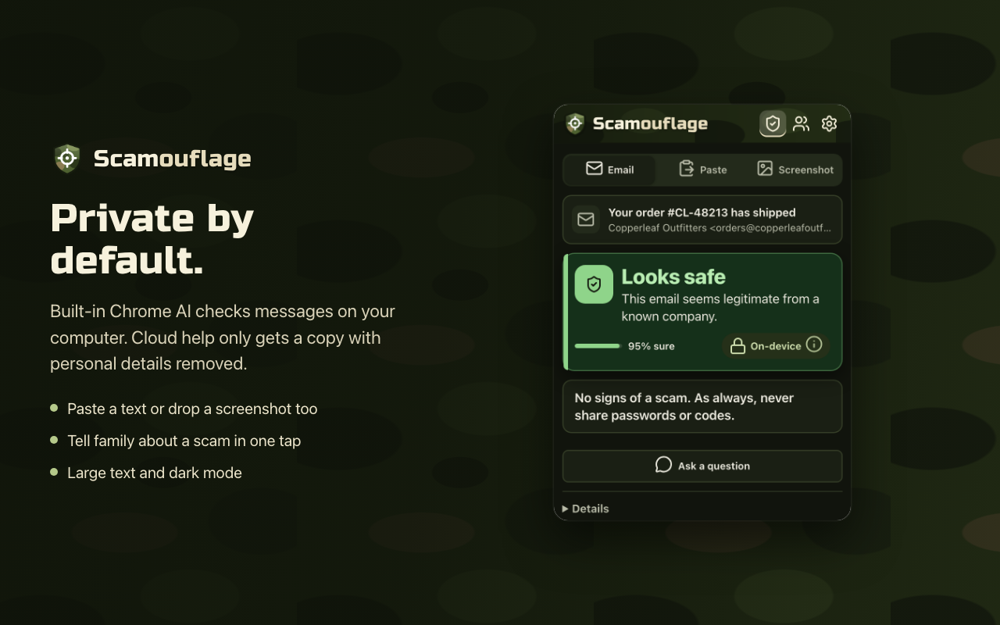
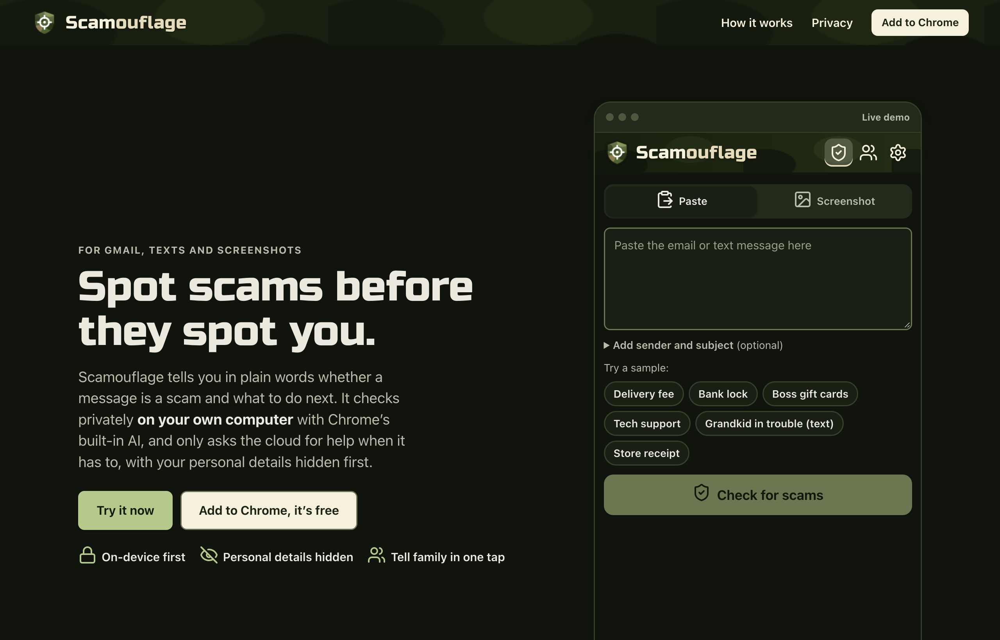

<!--
Final Devpost "About the project" text, as submitted. Images load from GitHub (raw URLs).
Re-render visuals: python3 scripts/banners/make.py && node scripts/banners/render-gifs.mjs && node scripts/banners/render-visuals.mjs
-->

### **🧩 [Add to Chrome](https://chromewebstore.google.com/detail/scamouflage/bcebmomgjaikeclnakgkkbdjmihdejgm)**  ·  **▶️ [Live web demo](https://scamouflage-37a72.web.app)**  ·  **🎬 [Demo video](https://youtu.be/DbJltFqxIac)**  ·  **💻 [Source code](https://github.com/vlww/Scamouflage)**  ·  **✅ [Testing guide](https://github.com/vlww/Scamouflage#testing-guide)**

---

## Overview

**Scamouflage is a Chrome extension that checks your emails for scams, right inside Gmail.** When you open an email, a small shield appears next to the subject: **Scam**, **Be Careful** or **Looks Safe**. Click it and a side panel tells you why in one plain sentence, and what to do next. You can also paste in a text message or drop in a screenshot of one.

The check runs on your own computer using **Gemini Nano**, the AI model that's built into Chrome. If your computer can't run it, Scamouflage asks Gemini in the cloud for help instead, but it removes your personal details first. **Firebase AI Logic hybrid inference** handles both.

It's made for the people scammers go after most: **elderly people, and the family members who look out for them.** It's available now on the **Chrome Web Store**, and there's also a **web app** version that runs the same panel in any browser tab.

---

## Value proposition

When a scary email shows up, people usually have a minute or two before they click a link, call a number or send money. Scamouflage is built for that minute:

- **🔒 Private:** your messages are checked on your own computer, not uploaded to someone else's server.
- **⚡ Instant:** the answer appears in under a second, right next to the email.
- **🎯 Clear:** one word, one reason, one next step. Nothing to figure out.
- **🆘 Helpful afterwards:** if you already clicked or paid, it tells you what to do now.
- **💸 Free:** checks on your computer cost nothing to run, so it can stay free for the people who need it.

Here's how it compares with what people use today:

| | Spam filter | Scam-checker website | AI chatbot | **Scamouflage** |
|---|---|---|---|---|
| Catches targeted scams | Often not | Yes | Yes | **Yes** |
| Your email stays private | Yes | No, you upload it | No, you paste it | **Yes, checked on your computer** |
| Works inside your inbox | Yes | No | No | **Yes** |
| Gives one clear answer | N/A | Sometimes | Rarely | **Always** |
| Helps if you already clicked | No | No | Sometimes | **Yes** |

---

## Inspiration

A lot of us have a parent or grandparent who forwards emails asking "is this real?" And a lot of us know someone who didn't ask in time.

The numbers are hard to ignore:

- Americans **over 60** reported **$7.75 billion** in losses to the FBI in 2025. That's up **59%** from the year before, more than any other age group, and **$38,500** per person on average ([FBI IC3 2025 report](https://www.ic3.gov/AnnualReport/Reports/2025_IC3Report.pdf)).
- **Phishing** was the most-reported crime of all, with 191,561 complaints ([FBI IC3 2025 report](https://www.ic3.gov/AnnualReport/Reports/2025_IC3Report.pdf)).
- Most fraud never gets reported. It's estimated the real cost to older adults in 2024 was **$10.1–81.5 billion** ([FTC report](https://www.ftc.gov/system/files/ftc_gov/pdf/P144400-OlderAdultsReportDec2025.pdf)).

None of the tools out there fit the moment. Spam filters miss scams written for one person. Scam-checker sites want you to upload your email. Chatbots give you paragraphs when you need a yes or no.

Chrome now comes with its own AI model, Gemini Nano. That means an email can be checked **right where it's read, privately, for free, in under a second**, and the cloud only needs to step in when it actually helps. That's exactly what hybrid inference is for.

---

## What it does

Scamouflage lives in two places: a small badge inside Gmail, and a side panel that explains the result. Most people only ever need the badge. The panel is there when you want to know why, or what to do next.

| Feature | What you get |
|---|---|
| 🛡️ **Shield in Gmail** | Open an email and a badge appears next to the subject: *Checking… → Scam / Be Careful / Looks Safe*. |
| 💬 **One clear answer** | "**Scam.** Asks you to pay a fake delivery fee. *Don't click, reply, or pay. Delete it.*" |
| 🔍 **Proof you can see** | Tap a warning sign: *Says harborviewbank.com · Really goes to harborview-verify.top*. The fake link lights up in the email. |
| 📥 **Inbox labels** | Emails you've opened keep their result in your inbox list. |
| 📋 **Texts and screenshots** | Paste any message, or drop in a screenshot of a text. |
| 🆘 **"I already clicked"** | A calm chat with numbered steps: call your bank, change your password, turn on 2-step verification, report it. |
| 🔁 **Second opinion** | If the on-device answer isn't sure, one tap asks a stronger model in the cloud. |
| 👪 **Tell my family** | One tap sends a short warning to someone you trust. They never see the email itself. |
| 🏷️ **Shows where it ran** | Every result says **🔒 On-device**, or **☁️ Cloud · 4 hidden** (4 personal details removed first). |

Once you've opened an email, its result stays in your inbox, so you can tell which messages are safe at a glance:

---

## How I used Firebase AI Logic

In Scamouflage, hybrid inference isn't just a backup plan. **Deciding where each check runs is what keeps your email private.** Every AI request goes through Firebase AI Logic, and where it runs depends on three things: what's in it, what you asked for, and whether Gemini Nano is ready.

| What's happening | Where it runs | Firebase AI Logic setup |
|---|---|---|
| Checking an email, Nano ready | 🔒 On your computer | `InferenceMode.ONLY_ON_DEVICE` + a JSON schema in `promptOptions.responseConstraint` |
| Checking an email, no Nano | ☁️ Cloud, personal details removed first | `PREFER_ON_DEVICE` + `inCloudParams.generationConfig.responseJsonSchema` |
| Automatic check when you open an email | 🔒 On your computer only | `ONLY_ON_DEVICE` |
| Nano still loading after Chrome starts | 🔒 + ☁️ Both start at once, the first answer is used | `ONLY_ON_DEVICE` and a redacted `ONLY_IN_CLOUD` backup |
| On-device answer isn't sure | ☁️ Second opinion, personal details removed | `ONLY_IN_CLOUD` with a stricter prompt |
| Screenshot | 🔒 On your computer | `expectedInputs: [text, image]` + `inlineData` |
| "I already clicked" chat | ☁️ Cloud, personal details removed | `startChat` + `sendMessageStream` |
| Setting up Gemini Nano for the first time | 🔒 On your computer | `initializeDeviceModel`, with a progress bar during setup |

A few choices made all the difference:

- **The full email only ever goes to `ONLY_ON_DEVICE`.** `PREFER_ON_DEVICE` would let the SDK send it to the cloud if Nano wasn't available. `ONLY_ON_DEVICE` makes that impossible.
- **Personal details are removed before the SDK gets to choose.** When Nano isn't ready, the cleaned-up copy is safe to send either way.
- **Automatic checks stay on your computer.** Opening an email never sends anything anywhere on its own. The cloud only helps when you press a button, and you can turn it off.
- **Cold starts don't make you wait.** Right after Chrome opens, Nano can take 20+ seconds to load. If you ask for a check during that time, the on-device check and a cloud backup start together. Whichever answers first is shown, and the other is cancelled.
- **The labels are honest.** The "On-device" or "Cloud" chip comes straight from the SDK's `inferenceSource`, so it always shows what actually ran.

---

## How I built it

Scamouflage is a Chrome extension (Manifest V3) with a side panel, a background worker and a script that runs inside Gmail. There's also a web app version. Both are built with Vite and plain JavaScript, and they share the same side panel and AI engine.

**Making Nano fast.** The first version took about **9 seconds** to check an email, and nothing showed up until the very end. Measuring showed that starting the model took about 1 ms. **Nearly all the time went into the words the model wrote**, so the fix was to have it write less and show its answer sooner:

- The answer format was cut down to the essentials, verdict first: `{ verdict, confidence, why, flags }`. The app writes the advice itself, so the model writes about a third as much.
- Emails are cleaned up before they're checked: quoted replies, signatures and footers are removed, and only one link per website is kept.
- The answer is **streamed** and read as it's written, so the verdict appears the moment it's ready.
- The model is warmed up when the panel opens. Creating a session doesn't load it, but a one-word prompt does.

| Measured on-device | Before | After |
|---|---|---|
| Verdict on screen | 7.9–9.2 s | **0.74–0.80 s** |
| Full result | 7.9–9.2 s | **2.7–2.9 s** |
| Long email with a reply thread | 3.0–6.2 s | **1.3–1.6 s** |
| Opening an email that was already checked | full re-check | **instant** |

**Removing personal details without losing the clues.** Before anything goes to the cloud, email addresses, phone numbers, card and account numbers, Social Security numbers, codes, names and street addresses are removed. What's kept is what gives a scam away: the sender's website, where links really go, amounts and wording.

**A quick first look.** Simple rules check for look-alike websites, links that don't go where they say, gift-card requests and pressure tactics in about **1 ms**, before the AI answers. Then, the AI determines whether something is actually a scam.

**Testing accuracy.** 18 realistic messages were run through the exact prompt the app uses:

| Route | Exact verdict | Scam vs. safe | Missed scams |
|---|---|---|---|
| On-device Gemini Nano | 16/18 | 17/18 | **0** |
| Cloud, personal details removed | 17/18 | 18/18 | **0** |

The test showed Nano flagging some real security notices as suspicious. Adjusting the prompt halved those false alarms.

**The rest of the Firebase stack** keeps it secure, tunable and social:

| Product | What it does |
|---|---|
| **App Check** | Protects every AI call. The extension uses a debug token, and the web app uses **reCAPTCHA Enterprise**. A build check keeps the token off the website. |
| **Remote Config** | Changes settings without a new release: which cloud model to use, input limits, timeouts, how long to wait before the cloud backup starts, the prompt version and feature switches. |
| **Authentication** | Anonymous sign-in for family sharing, with no email or password needed. |
| **Cloud Firestore** | Stores family groups and shared warnings. Security rules only let you add yourself to a family. |
| **Hosting** | Hosts the web app and landing page. |

On top of that, there are 79 automated tests, code linting, and a script that checks every color combination is easy to read.

---

## Product design

Every design choice started with the target audience of elderly people, who are most likely to fall victim to email scams. Imagine a grandparent, worried about their bank account, using a laptop with the text zoomed in.

However, this tool can be used by anyone! It helps to have a second pair of eyes whenever you aren't sure if an email is legitimate, or if a link might be safe to click. In fact, I've been using Scamouflage myself since I've developed it!

- **The answer comes first.** One word (**Scam**, **Be Careful** or **Looks Safe**), then one line explaining why, then one thing to do.
- **Visual results.** Every result has a word, an icon and a color, and the contrast is checked automatically.
- **Easy to read.** There's a text-size slider, plus keyboard and screen-reader support.
- **Respectful to the user.** The "I already clicked" chat helps address mistakes, starting with what to do right now.
- **Honest about privacy.** Every result shows where the check ran and how many personal details were hidden.
- **No false alarms in the inbox.** Inbox labels only appear on emails that were fully checked by the model.
- **A complete product.** There's a setup guide that downloads the on-device model, settings, family sharing, a privacy policy, a landing page and a Chrome Web Store listing.

The web app puts the real panel right on the landing page, so anyone can try it without installing anything:

---

## Potential impact

- **A real problem that's getting worse.** Americans over 60 lost $7.75 billion in 2025, and phishing is the most-reported crime of all, let alone other types of email scams.
- **A specific audience.** Elderly people who read Gmail on a computer, and the grown children who worry about them. Family sharing is built for that relationship: one tap from a parent sends the warning to a trusted family member.
- **The right moment.** Scams work in the minute between opening a message and acting on it. Scamouflage answers inside that minute, before the click.
- **Privacy is why people say no.** People won't hand their inbox to a stranger. With checks on their own computer, they don't have to. And because the cloud can step in, it still works on computers that can't run Nano.
- **Free to run.** Checks on your computer cost nothing, so it can stay free.
- **Available today.** It's on the Chrome Web Store, works on any desktop Chrome, and doesn't need an account.

---

## Challenges

- **Slow first checks.** Right after Chrome opens, Nano could take 20+ seconds to answer, and it turned out that creating a session doesn't actually load the model. A proper warm-up, smarter timeouts that keep a half-finished answer, and the cloud backup fixed it. Now the first check after a restart feels like every other one.
- **The SDK's fallback behavior.** `PREFER_ON_DEVICE` doesn't switch to the cloud if the on-device check fails halfway through. So each request picks its mode explicitly, and the retry and backup logic was built and tested separately.
- **Gmail keeps changing.** Gmail redraws its page constantly. The badge has backup ways of finding the email, keeps its own styling so Gmail can't break it, and puts itself back whenever Gmail redraws.
- **App Check inside an extension.** reCAPTCHA can't run in extensions, so the extension uses a debug token while the web app uses reCAPTCHA Enterprise. A build check makes sure the token never ends up on the website.

---

## Accomplishments

- **Shipped in a week.** During the hackathon, I not only completely built this project, but I was able to get it published as a **[Chrome Web Store](https://chromewebstore.google.com/detail/scamouflage/bcebmomgjaikeclnakgkkbdjmihdejgm)** extension and a [live web app](https://scamouflage-37a72.web.app/), with family sharing and a privacy policy.
- **10x faster first answer:** throughout building Scamouflage, I got the model to determine the result in under 1 second, which was significantly faster than the 20 seconds it initially took.
- **0 missed scams** in testing, both on-device and in the cloud. When using the Chrome extension myself, I found that it was very accurate in correctly determining the legitimacy of emails.
- **Private by design:** the full email has no way to reach the cloud, protecting the user's data.
- **No more waiting on slow starts,** without giving up privacy, and with tests to prove it works.

---

## What I learned

- **Measure before you optimize.** I assumed loading the model was the slow part. It was actually how much the model wrote. With on-device AI, a shorter answer means a faster answer.
- **Small models do best with clear jobs.** A tight set of rules and short answer format made Nano faster *and* more accurate.
- **Hybrid inference is a product decision.** Deciding which requests can leave the computer, and in what form, shaped the whole app: the On-device/Cloud chip, the "4 hidden" count, and the rule that automatic checks stay local.
- **Even a small test set helps.** Eighteen messages were enough to catch false alarms I'd never have noticed by hand.

---

## What's next

- **More email apps:** Outlook and Yahoo on the web.
- **More languages,** since scams target every community.
- **Android,** using Gemini Nano through Firebase AI Logic, so text messages get the same private check.
- **A bigger public test set,** ideally built with consumer-protection groups.

**Built with:** Firebase AI Logic (Gemini Nano on-device + Gemini 3.5 Flash-Lite in the cloud) · Firebase App Check · Firebase Remote Config · Firebase Authentication · Cloud Firestore · Firebase Hosting · Chrome Prompt API · Chrome Extensions (Manifest V3) · JavaScript · Vite · Vitest
