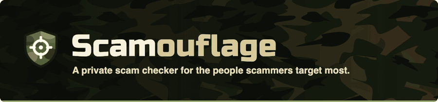
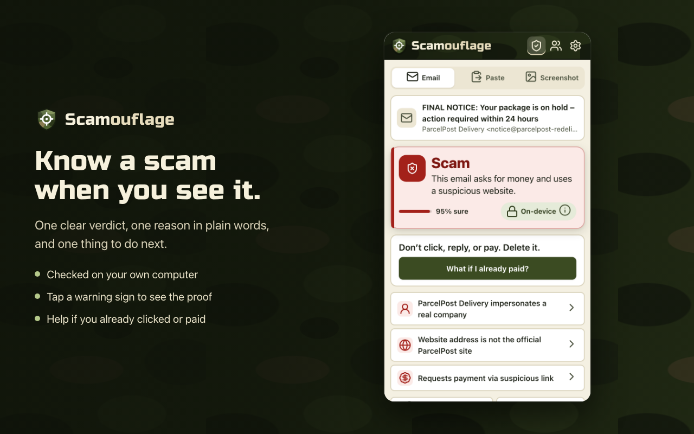

<!--
Devpost "About the project": paste everything below the line.
Banners load from GitHub (raw URLs), so push before pasting. Devpost doesn't render Markdown tables,
so this file uses lists only. Re-render banners: python3 scripts/banners/make.py && node scripts/banners/render-gifs.mjs
Elevator pitch field (≤200 chars): A private scam checker for Gmail, texts and screenshots. Gemini Nano checks on your device in under a second; Firebase AI Logic hybrid inference adds redacted cloud help only when needed.
-->

---

**🧩 [Add to Chrome (Chrome Web Store)](https://chromewebstore.google.com/detail/scamouflage/bcebmomgjaikeclnakgkkbdjmihdejgm)** · **▶ [Live web app](https://scamouflage-37a72.web.app)** · **💻 [Source code (Apache-2.0)](https://github.com/vlww/Scamouflage)** · **✅ [Testing guide](https://github.com/vlww/Scamouflage#testing-guide)**

**Scamouflage tells you, in plain words, whether an email, text or screenshot is a scam, and what to do next, without sending your messages to anyone.** Chrome's built-in Gemini Nano checks the message on your own computer and puts a verdict on screen in **under a second**. Through **Firebase AI Logic hybrid inference**, the cloud helps only when it must: when the device can't run the model, when it's still loading, when it's unsure, or when you want to talk it through. Even then, it only ever sees a copy with your personal details removed.

It's built for the people scammers target most, **older adults and the family members who look out for them**. It's live today as a **Chrome extension on the Chrome Web Store** and as a **hosted web app**, both running the same hybrid engine.

Most of us know someone who has forwarded an email with "is this real?", and someone who didn't ask in time.

The numbers back that up. In 2025, Americans over 60 reported **$7.75 billion** in losses to the FBI's Internet Crime Complaint Center, up **59%** in a single year and more than any other age group, at an average of **$38,500** per person ([FBI IC3 2025 report](https://www.ic3.gov/AnnualReport/Reports/2025_IC3Report.pdf), pp. 6 and 44). **Phishing** was the most-reported crime of all, with 191,561 complaints (p. 7). And that's only what gets reported: the FTC estimates the real 2024 cost of fraud against older adults at **$10.1–81.5 billion** ([FTC, *Protecting Older Consumers 2024–2025*](https://www.ftc.gov/system/files/ftc_gov/pdf/P144400-OlderAdultsReportDec2025.pdf), pp. 1–2).

When I looked at what exists, I found a gap:

- **Spam filters** catch bulk spam, but a targeted "your package is on hold" email lands in the inbox looking real.
- **Scam-checker sites and apps** ask you to upload or forward your email to their servers. For a frightened person reading a message about their bank, that's a privacy problem of its own.
- **General chatbots** answer with paragraphs of "it depends", when the reader needs a decision and one next step.

On-device AI changes what's possible. With Gemini Nano built into Chrome, a message can be checked **where it's read, privately, for free, in under a second**, with the cloud kept for the moments it adds real value. That's exactly the shape of problem hybrid inference was made for.

- **A shield right in Gmail.** Open an email and a small badge appears next to the subject: *Checking… → Scam / Be careful / Looks safe*. Emails you've opened keep their label in the inbox list.
- **One verdict, one reason, one action.** "**Scam.** Asks you to pay a fake delivery fee. *Don't click, reply, or pay. Delete it.*" The action adapts to the scam: payment scams offer *What if I already paid?*, call-this-number scams offer *What if I already called them?*
- **Proof you can see.** Tap a warning sign: *Says harborviewbank.com · Really goes to harborview-verify.top*. The disguised link lights up inside the email.
- **Texts and screenshots too.** Paste any message, or drop a screenshot of a text or DM; the on-device multimodal model reads it.
- **"I already clicked."** The Debrief chat gives calm, numbered recovery steps (call the bank using the number on your card, change the password, turn on 2-step verification, report it), and never blames the reader.
- **A second opinion** from a stronger cloud model, one tap away when the on-device answer is unsure.
- **Tell my family.** One tap shares a short warning with a trusted person who joined with a family code. Only a summary is shared, never the message.
- **An honest route chip** on every result: **🔒 On-device**, or **☁️ Cloud · 4 hidden** showing how many personal details were removed first.

In Scamouflage, hybrid inference isn't a fallback added at the end. **The routing is the privacy model.** Every request goes through Firebase AI Logic (`firebase/ai`: `getAI`, `getGenerativeModel`, `generateContentStream`, `startChat`), and its route is chosen by what the request contains, what the user asked for, and whether Gemini Nano is ready:

- **Scan, Nano ready → `InferenceMode.ONLY_ON_DEVICE`.** Structured output comes from `onDeviceParams.promptOptions.responseConstraint` (a JSON schema). I deliberately use `ONLY_ON_DEVICE` rather than `PREFER_ON_DEVICE`: the unredacted email *cannot* be routed to the cloud, by construction.
- **Scan, Nano not available → redact first, then `PREFER_ON_DEVICE`** with `inCloudParams.generationConfig.responseJsonSchema`. Because the text is already redacted, whichever route the SDK picks is private. It works on any Chrome.
- **Automatic checks (an email is opened) → on-device only.** Opening an email never sends anything anywhere by itself.
- **Cold start → a race.** Right after Chrome starts, Nano can take 20+ seconds to load. For a check the user asked for, Scamouflage starts the on-device request *and* a redacted `ONLY_IN_CLOUD` backup. The first route to stream a verdict wins, and the other is cancelled with an `AbortSignal`. If Nano hasn't loaded yet, the backup starts after 0.3 s; once it has, only after 5 s.
- **Unsure → second opinion, `ONLY_IN_CLOUD`, redacted,** with a stricter prompt. Offered only when the on-device verdict is "Be careful" or below a confidence threshold.
- **Screenshot → on-device multimodal** (`expectedInputs: [text, image]`, `inlineData`). Images can't be redacted, so they only go to the cloud if the user allows cloud help.
- **Debrief → cloud chat** (`startChat` + `sendMessageStream`), redacted, because multi-turn chat isn't available on-device.
- **Model download → `initializeDeviceModel`**, started from a button in onboarding, with a progress bar.

The route chip reads the SDK's `inferenceSource`, so what the user sees is what actually ran. All of this is in [`src/ai.js`](https://github.com/vlww/Scamouflage/blob/main/src/ai.js) and covered by 11 routing tests with a mocked SDK.

**Supporting Firebase products:**

- **App Check** protects every AI Logic call: a debug token in the extension (reCAPTCHA can't run on `chrome-extension://` pages), and **reCAPTCHA Enterprise** on the web app. A build check fails the web build if the debug token ever appears in it.
- **Remote Config** tunes the engine live: cloud model, input caps, the escalation threshold, timeouts, the hedge delay, the prompt version and three feature flags.
- **Authentication** (anonymous, through `firebase/auth/web-extension` for MV3) and **Cloud Firestore** power family sharing, with security rules that let people add only *themselves* to a circle and validate every field of a shared report.
- **Hosting** serves the web app and landing page.

Scamouflage is a Manifest V3 Chrome extension (side panel, service worker, Gmail content script) and a web app, built with Vite and vanilla JavaScript. Both platforms share one side-panel codebase and one engine. On the web, a small shim stands in for the `chrome.*` APIs.

**Making Nano fast.** My first prototype took **7.9–9.2 seconds** on-device, with nothing on screen until the end. I measured before optimizing: session creation was about 1 ms, so **output tokens were the cost**. What changed:

- **A tiny, verdict-first schema:** `{ verdict, confidence, why, flags≤3 }`. The UI derives the advice from the verdict, so output dropped from about 1,000 to about 350 characters.
- **Shrunk input:** quoted replies, signatures and legal footers are stripped, the body is capped at about 1,800 characters, and links are deduplicated, one per domain.
- **Text-only sessions.** The SDK's default declares image input on every session; text scans don't need the image encoder.
- **Streaming through a partial-JSON parser,** so the verdict renders the moment its string closes.
- **A real warm-up.** Creating a session doesn't load Nano's weights, but a one-word prompt does, so the panel warms the model while the user reads.

The result: **verdict on screen in 0.74–0.80 s, complete result in about 2.7 s**, a 10× faster first answer.

**An instant first answer.** Before any AI runs, local "recon" rules check for look-alike domains, link text that doesn't match its destination, gift-card and wire requests, urgency and secrecy pressure, in about **1 ms**. They're always shown as a cautious "Be careful?" and never as "Scam": a heuristic can warn, but only a model check can convict.

**Redaction that keeps the evidence.** Before anything goes to the cloud, Scamouflage removes email addresses, phone numbers, Luhn-checked card numbers, bank, IBAN and account numbers, SSNs, codes, names in greetings, street addresses and URL tracking tokens. It keeps sender and link **domains**, amounts and wording, because those are what reveal a scam.

**Measured accuracy.** An 18-message eval set of invented scams and genuine messages runs through the exact production prompt:

- **On-device Gemini Nano:** 16/18 exact, 17/18 scam-vs-safe, **0 missed scams**, verdict in 0.71 s (median)
- **Cloud, redacted:** 17/18 exact, 18/18 scam-vs-safe, 0 missed scams

The eval drove a prompt fix that halved on-device false alarms on genuine security notices.

**Quality gates:** 79 unit tests (redaction, recon, input cleanup, partial JSON and the on-device/cloud race), ESLint, and an automated WCAG contrast check of every color pair in both themes.

The person on the other end may be 78, worried about their bank account, and reading on a laptop with the text zoomed in. Every design decision started there:

- **Decision first.** The screen leads with one word (**Scam**, **Be careful**, **Looks safe**), then one line of why, then one action. No scores to interpret, no jargon.
- **Never color alone.** Every verdict has a word, an icon and a color. WCAG AA contrast is checked automatically in light and dark themes.
- **Readable for real.** A five-step text-size slider, full keyboard and screen-reader support, and reduced motion.
- **Calm, never blaming.** The Debrief is written for someone who already clicked and feels foolish. It starts with what to do now.
- **Honest about privacy.** The route chip always shows where the check ran and how many details were hidden. Cloud help can be turned off entirely.
- **No false alarms on real mail.** Inbox labels only appear on emails that were fully checked. A heuristic guess is never shown as a "Scam" label.
- **A complete product, not a demo.** A three-step onboarding that downloads the on-device model, settings, a privacy policy, a family flow, a published store listing and a landing page. It's an army-green camouflage identity, because the scams are the ones in disguise.

- **A real problem, measured:** $7.75 billion lost by Americans over 60 in 2025 (FBI IC3), and phishing as the single most-reported crime type.
- **A specific audience:** older adults who read email in Gmail on a desktop Chrome, and the adult children who worry about them. Family sharing is built for that relationship. A parent's one tap puts the warning on their child's screen, so the person who looks out for them knows before money moves.
- **The moment that matters.** Scams succeed in the minute between opening a message and acting on it. Scamouflage answers inside that minute, in the inbox, before a click.
- **Privacy is the adoption barrier, so I removed it.** People won't hand their inbox to a stranger's server. On-device checks mean they don't have to, and the redacted cloud path means the product still works on computers that can't run Nano.
- **Free to run at scale.** On-device checks cost nothing per message, so the product stays free for the people who need it most, and cloud cost only appears where it adds value.
- **Usable today.** It's published on the Chrome Web Store and works on any desktop Chrome, with no account and no setup beyond one click.

- **Cold starts.** Right after Chrome launches, Nano can take 20+ seconds to answer its first prompt, and I found that creating a session doesn't actually load the weights. I built a real warm-up, activity-based timeouts (time to first token, then idle time between tokens), keeping a partial verdict if the stream stalls, and the redacted cloud race. The first check after a restart now feels like every other check.
- **The SDK's routing semantics.** `PREFER_ON_DEVICE` doesn't retry in the cloud if the on-device call fails mid-stream. So I built the retry and race logic myself, with explicit modes per request, and tested it against a mocked SDK.
- **Gmail's ever-changing page.** Gmail re-renders constantly. The content script uses fallback selectors, keeps the badge in a Shadow DOM, re-attaches it with a mutation observer, and matches inbox rows by thread ID.
- **App Check outside a normal web page.** reCAPTCHA can't run on `chrome-extension://` pages, so the extension uses a debug token, while the web app uses reCAPTCHA Enterprise. A build check guarantees the token never ships on the website.
- **Writing for a frightened reader.** The hardest editing was cutting every sentence that didn't help someone decide what to do next.

- **Shipped:** live on the **Chrome Web Store** and as a **hosted web app**, with a privacy policy, landing page and family sharing.
- **10× faster first answer** on-device: from 7.9–9.2 s to **0.74–0.80 s**, measured.
- **0 missed scams** on the eval set, on-device and in the cloud.
- **Privacy by construction:** the unredacted email can't reach the cloud, because the only route that sees it is `ONLY_ON_DEVICE`.
- **A hybrid race** that hides cold starts without giving up privacy, covered by tests.
- **Accessible:** WCAG AA in both themes, checked by a script, not by eye.

- **Measure before optimizing.** I assumed session creation was slow; it was output tokens. Schema design is a performance tool for on-device models.
- **On-device models want small, sharp jobs.** A tight rubric and a tiny schema made Nano both faster and more accurate than a big "explain everything" prompt.
- **Hybrid inference is a product decision, not just a technical one.** Deciding *which* requests may leave the device, and in what form, shaped the whole experience: the route chip, the redaction counter and the automatic-checks-stay-local rule all came from that.
- **Evals change prompts.** A small, honest eval set caught false alarms on genuine security notices that I would never have spotted by hand.

- **More inboxes:** Outlook and Yahoo on the web.
- **A weekly family digest:** "what Scamouflage caught this week", for the person who looks out for a parent.
- **More languages,** since scams target every community. The on-device model makes a localized UI the main work.
- **Android,** with Gemini Nano via Firebase AI Logic, so texts get the same private check.
- **A larger, public eval set,** built with consumer-protection groups, to track accuracy as models change.

**Everything was built during the #BuildHybridAI 2026 submission period,** starting with the first commit on November 24, 2026: the hybrid engine and routing, the speed work, the Gmail integration, the side-panel UI, family sharing, the eval set, the web app and the Chrome Web Store release. **No pre-existing code is included** beyond open-source libraries (Firebase JS SDK, Vite, Vitest, Lucide icons, the Russo One font), which are credited in the repository. Every brand, person and domain in the sample messages and demo assets is invented, and no third-party logos appear anywhere.

**Platforms:** Web (Chrome): a Chrome extension and a web app.

**Built with:** Firebase AI Logic (hybrid inference: Gemini Nano on-device + Gemini 3.5 Flash-Lite in the cloud) · Firebase App Check (debug token + reCAPTCHA Enterprise) · Firebase Remote Config · Firebase Authentication · Cloud Firestore · Firebase Hosting · Chrome Prompt API · Chrome Extensions Manifest V3 · JavaScript · Vite · Vitest · Lucide icons
