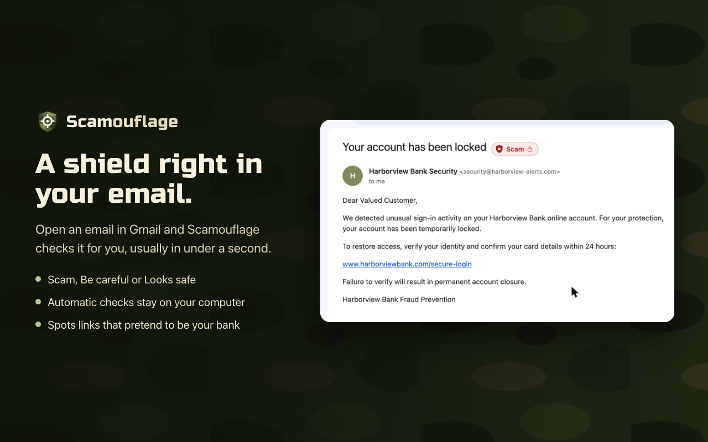
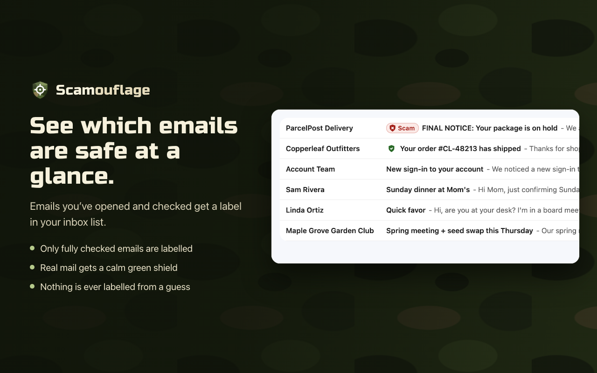
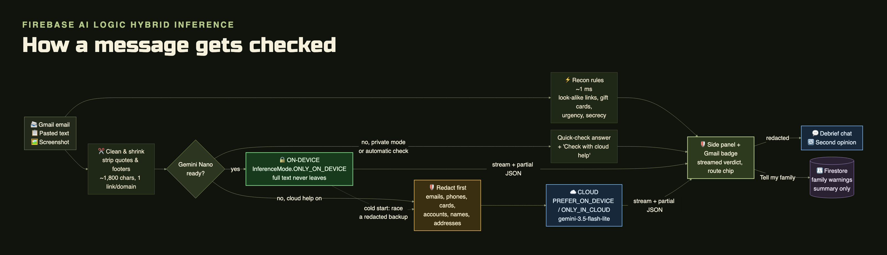

<!--
Devpost "About the project": paste everything below the line.
Images load from GitHub (raw URLs), so push before pasting. Check the Devpost preview: if tables show as
plain text with | pipes, tell me and I'll turn them into images.
Re-render visuals: python3 scripts/banners/make.py && node scripts/banners/render-gifs.mjs && node scripts/banners/render-visuals.mjs
Elevator pitch field (≤200 chars): A Chrome extension that spots scam emails, texts and screenshots privately on your computer with Gemini Nano, using Firebase AI Logic hybrid inference for redacted cloud help.
-->

---

**🧩 [Add to Chrome](https://chromewebstore.google.com/detail/scamouflage/bcebmomgjaikeclnakgkkbdjmihdejgm)** · **▶ [Live web demo](https://scamouflage-37a72.web.app)** · **💻 [Source code](https://github.com/vlww/Scamouflage)** · **✅ [Testing guide](https://github.com/vlww/Scamouflage#testing-guide)**

## Overview

**Scamouflage is a Chrome extension that checks your emails for scams, right inside Gmail.** Open an email and a small shield appears next to the subject: **Scam**, **Be careful** or **Looks safe**. Click it and a side panel tells you why in one plain sentence, and what to do next. You can also paste a text message or drop in a screenshot of one.

The check runs **on your own computer** with Gemini Nano, the AI model built into Chrome. When that isn't possible, Scamouflage asks Gemini in the cloud for help, but only after removing your personal details. **Firebase AI Logic hybrid inference** handles both routes.

It's built for the people scammers go after most: **older adults, and the family members who look out for them.** It's live on the **Chrome Web Store**, and there's also a **web app** version that runs the same panel and the same AI engine in any browser tab.

## Value proposition

When a scary email lands, people have a minute or two before they click, call or pay. Scamouflage is built for that minute:

- **🔒 Private:** your messages are checked on your own computer, not uploaded to someone's server.
- **⚡ Instant:** the verdict appears in under a second, right next to the email.
- **🎯 Clear:** one word, one reason, one next step. Nothing to interpret.
- **🆘 Helpful afterwards:** already clicked or paid? It tells you what to do now, calmly.
- **💸 Free:** on-device checks cost nothing to run, so the product can stay free for the people who need it.

| | Spam filter | Scam-checker website | AI chatbot | **Scamouflage** |
|---|---|---|---|---|
| Catches targeted scams | Often not | Yes | Yes | **Yes** |
| Your email stays private | Yes | No, you upload it | No, you paste it | **Yes, checked on your computer** |
| Works inside your inbox | Yes | No | No | **Yes** |
| Gives one clear answer | n/a | Sometimes | Rarely | **Always** |
| Helps if you already clicked | No | No | Sometimes | **Yes** |

## Inspiration

Most of us know someone who has forwarded an email asking "is this real?" And most of us know someone who didn't ask in time.

The numbers are hard to ignore:

- Americans **over 60** reported **$7.75 billion** in losses to the FBI in 2025. That's up **59%** in one year, more than any other age group, and **$38,500** per person on average ([FBI IC3 2025 report](https://www.ic3.gov/AnnualReport/Reports/2025_IC3Report.pdf), pp. 6 and 44).
- **Phishing** was the most-reported crime of all, with 191,561 complaints (p. 7).
- That's only what gets reported. The FTC estimates the real cost to older adults in 2024 at **$10.1–81.5 billion** ([FTC report](https://www.ftc.gov/system/files/ftc_gov/pdf/P144400-OlderAdultsReportDec2025.pdf), pp. 1–2).

When I looked at what's out there, none of it fit. Spam filters miss targeted scams. Scam-checker sites want you to upload your email. Chatbots answer with paragraphs when you need a decision.

Then I realized Chrome now ships with its own AI model, Gemini Nano. That means a message can be checked **right where it's read, privately, for free, in under a second**. The cloud can be saved for the moments it actually adds something. That's exactly what hybrid inference is for.

## What it does

| Feature | What you get |
|---|---|
| 🛡️ **Shield in Gmail** | Open an email and a badge appears next to the subject: *Checking… → Scam / Be careful / Looks safe*. |
| 💬 **One clear answer** | "**Scam.** Asks you to pay a fake delivery fee. *Don't click, reply, or pay. Delete it.*" |
| 🔍 **Proof you can see** | Tap a warning sign: *Says harborviewbank.com · Really goes to harborview-verify.top*. The fake link lights up in the email. |
| 📥 **Inbox labels** | Emails you've opened keep their verdict in the inbox list. |
| 📋 **Texts and screenshots** | Paste any message, or drop in a screenshot of a text or DM. |
| 🆘 **"I already clicked"** | A calm chat with numbered recovery steps: call your bank, change the password, turn on 2-step verification, report it. |
| 🔁 **Second opinion** | When the on-device answer is unsure, one tap asks a stronger cloud model. |
| 👪 **Tell my family** | One tap sends a short warning to someone you trust. Never the email itself. |
| 🏷️ **Honest route chip** | Every result says where it ran: **🔒 On-device**, or **☁️ Cloud · 4 hidden** (personal details removed). |

## How I used Firebase AI Logic

In Scamouflage, hybrid inference isn't a backup plan. **Choosing where each check runs is what keeps people's email private.** Every AI request goes through Firebase AI Logic (`getAI`, `getGenerativeModel`, `generateContentStream`, `startChat`), and gets a route based on what's in it, what the user asked for, and whether Gemini Nano is ready.

| What's happening | Where it runs | Firebase AI Logic setup |
|---|---|---|
| Checking an email, Nano ready | 🔒 On your computer | `InferenceMode.ONLY_ON_DEVICE` + a JSON schema in `promptOptions.responseConstraint` |
| Checking an email, no Nano | ☁️ Cloud, redacted first | `PREFER_ON_DEVICE` + `inCloudParams.generationConfig.responseJsonSchema` |
| Automatic check when you open an email | 🔒 On your computer only | `ONLY_ON_DEVICE` |
| Nano still loading after Chrome starts | 🔒 + ☁️ raced | `ONLY_ON_DEVICE` vs. a redacted `ONLY_IN_CLOUD` backup |
| On-device answer unsure | ☁️ Second opinion, redacted | `ONLY_IN_CLOUD` with a stricter prompt |
| Screenshot | 🔒 On your computer | multimodal `expectedInputs: [text, image]` + `inlineData` |
| "I already clicked" chat | ☁️ Cloud, redacted | `startChat` + `sendMessageStream` |
| Downloading the model | 🔒 | `initializeDeviceModel`, with a progress bar in onboarding |

The decisions that matter most:

- **`ONLY_ON_DEVICE`, not `PREFER_ON_DEVICE`, for the raw email.** With "prefer", the SDK could send the email to the cloud if Nano isn't available. With "only", the unredacted email *can't* leave the computer.
- **Redact first, then let the SDK choose.** When Nano isn't ready, personal details are removed before the call, so either route is private.
- **Automatic checks stay local.** Opening an email never sends anything anywhere on its own. The cloud only helps when you press a button, and you can turn it off.
- **A race for cold starts.** Right after Chrome launches, Nano can take 20+ seconds to load. For a check you asked for, Scamouflage starts the on-device request and a redacted cloud backup together. Whichever answers first wins, and the other is cancelled.
- **Honest labels.** The route chip reads the SDK's `inferenceSource`, so what you see is what actually ran.

All of this lives in [`src/ai.js`](https://github.com/vlww/Scamouflage/blob/main/src/ai.js), and the race is covered by tests against a mocked SDK.

## How I built it

Scamouflage is a Manifest V3 Chrome extension (side panel, background worker, Gmail script) plus a web app, built with Vite and plain JavaScript. Both share one side panel and one AI engine.

**Making Nano fast.** My first prototype took about **9 seconds** to check an email, with nothing on screen until the end. I measured before changing anything: starting the model took about 1 ms, and **almost all the time went into the words the model wrote**. So:

- I shrank the answer to a tiny, verdict-first format: `{ verdict, confidence, why, flags }`. The app writes the advice, so the model writes about a third as much.
- I cleaned up the input: quoted replies, signatures and footers are stripped, and only one link per website is kept.
- I **streamed** the answer through a small parser, so the verdict appears the moment it's written.
- I warmed the model up properly. Creating a session doesn't load it, but a one-word prompt does.

| Measured on-device | Before | After |
|---|---|---|
| Verdict on screen | 7.9–9.2 s | **0.74–0.80 s** |
| Full result | 7.9–9.2 s | **2.7–2.9 s** |
| Long email with a reply thread | 3.0–6.2 s | **1.3–1.6 s** |
| Re-opening a checked email | full re-check | **instant** |

**Removing personal details without losing the clues.** Before anything goes to the cloud, Scamouflage removes email addresses, phone numbers, card and account numbers, SSNs, codes, names and street addresses. It keeps what reveals a scam: the sender's domain, where links really go, amounts and wording.

**A quick first look.** Simple rules check for look-alike domains, mismatched links, gift-card requests and pressure tactics in about **1 ms**, before the AI answers. They only ever say "Be careful?". A rule can raise a flag, but only the AI can call something a scam.

**Testing accuracy.** I wrote 18 realistic, invented messages (11 scams, 7 genuine, 1 borderline) and ran them through the exact production prompt:

| Route | Exact verdict | Scam vs. safe | Missed scams |
|---|---|---|---|
| On-device Gemini Nano | 16/18 | 17/18 | **0** |
| Cloud, redacted | 17/18 | 18/18 | **0** |

The test caught Nano flagging genuine security notices, and one prompt fix halved those false alarms.

**The rest of the Firebase stack:**

| Product | What it does |
|---|---|
| **App Check** | Protects every AI call. A debug token in the extension, and **reCAPTCHA Enterprise** on the web app. A build check keeps the token off the website. |
| **Remote Config** | Tunes the engine live: cloud model, input limits, timeouts, the race delay, the prompt version and feature switches. |
| **Authentication** | Anonymous sign-in for family sharing, with no email or password. |
| **Cloud Firestore** | Family groups and shared warnings, with rules that only let you add yourself to a family. |
| **Hosting** | The web app and landing page. |

On top of that: 79 automated tests, code linting, and a script that checks every color combination meets accessibility contrast standards.

## Product design

I pictured the person on the other end: maybe 78, worried about their bank account, reading on a laptop with the text zoomed in. Every design choice started there.

- **The answer comes first.** One word (**Scam**, **Be careful**, **Looks safe**), then one line of why, then one thing to do.
- **Never color alone.** Every verdict has a word, an icon and a color, and contrast is checked automatically in light and dark mode.
- **Easy to read.** A text-size slider, keyboard and screen-reader support, and reduced motion.
- **Kind, never blaming.** The "I already clicked" chat is written for someone who feels foolish. It starts with what to do now.
- **Honest about privacy.** The route chip always shows where the check ran and how many details were hidden.
- **No false alarms in the inbox.** Labels only appear on emails that were fully checked. A rule's guess is never shown as "Scam".
- **A whole product, not a demo.** Onboarding that downloads the on-device model, settings, family sharing, a privacy policy, a landing page and a Chrome Web Store listing.

The army-green camouflage look is a small joke with a point: the scams are the ones in disguise.

## Potential impact

- **A real, growing problem.** $7.75 billion lost by Americans over 60 in 2025, and phishing is the most-reported crime of all.
- **A specific audience.** Older adults who read Gmail on a computer, and the grown children who worry about them. Family sharing is built for exactly that relationship: one tap from a parent puts the warning on their child's screen before any money moves.
- **The right moment.** Scams work in the minute between opening a message and acting on it. Scamouflage answers inside that minute, before the click.
- **Privacy is why people say no, so I removed it.** People won't hand their inbox to a stranger. With on-device checks, they don't have to. And the redacted cloud route means it still works on computers that can't run Nano.
- **Free to run.** On-device checks cost nothing per message, so it can stay free.
- **Available today.** It's on the Chrome Web Store, works on any desktop Chrome, and needs no account.

## Challenges

- **Cold starts.** Right after Chrome launches, Nano could take 20+ seconds to answer, and I found that creating a session doesn't actually load the model. I fixed it with a real warm-up, smarter timeouts that keep a half-finished answer, and the on-device vs. cloud race. Now the first check after a restart feels like every other one.
- **The SDK's fallback behavior.** `PREFER_ON_DEVICE` doesn't fall back to the cloud if the on-device call fails partway through. So I picked the mode for each request myself, built my own retry and race logic, and tested it against a fake SDK.
- **Gmail keeps changing.** Gmail redraws its page constantly. The Gmail script has backup selectors, keeps the badge isolated so Gmail's styles can't break it, and re-attaches it whenever Gmail redraws.
- **App Check inside an extension.** reCAPTCHA can't run in extensions, so the extension uses a debug token, and the web app uses reCAPTCHA Enterprise. A build check makes sure the token never ends up on the website.
- **Writing for a scared reader.** The hardest editing was cutting every sentence that didn't help someone decide what to do.

## Accomplishments

- **Shipped in a week.** From a first idea on November 23 to a published **Chrome Web Store** extension and a hosted web app, with family sharing and a privacy policy.
- **10× faster first answer:** from 9 seconds to under one, measured.
- **0 missed scams** in testing, on-device and in the cloud.
- **Private by design:** the unredacted email simply has no way to reach the cloud.
- **A race that hides cold starts** without giving up privacy, with tests to prove it.
- **Accessible:** AA contrast in both themes, checked by a script, not by eye.

## What I learned

- **Measure before you optimize.** I assumed starting the model was slow. It was the length of the answer. For on-device models, the answer format *is* a performance setting.
- **Small models like small, sharp jobs.** A tight set of rules and a tiny answer format made Nano faster *and* more accurate.
- **Hybrid inference is a product decision.** Deciding which requests may leave the device, and in what form, shaped the whole app: the route chip, the "4 hidden" counter, and the rule that automatic checks stay local.
- **Even a small test set changes things.** Eighteen messages were enough to catch false alarms I'd never have spotted by hand.

## What's next

- **More inboxes:** Outlook and Yahoo on the web.
- **A weekly family digest:** "here's what Scamouflage caught this week", for the person looking out for a parent.
- **More languages.** Scams target every community.
- **Android,** with Gemini Nano through Firebase AI Logic, so text messages get the same private check.
- **A bigger, public test set,** ideally built with consumer-protection groups.

**Built with:** Firebase AI Logic (Gemini Nano on-device + Gemini 3.5 Flash-Lite in the cloud) · Firebase App Check · Firebase Remote Config · Firebase Authentication · Cloud Firestore · Firebase Hosting · Chrome Prompt API · Chrome Extensions (Manifest V3) · JavaScript · Vite · Vitest
